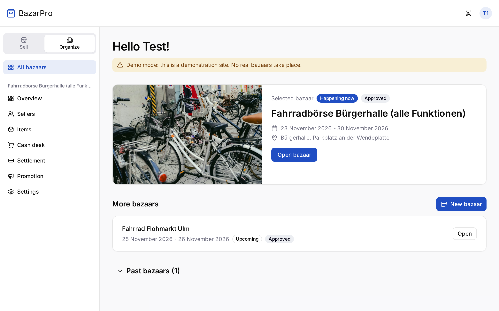
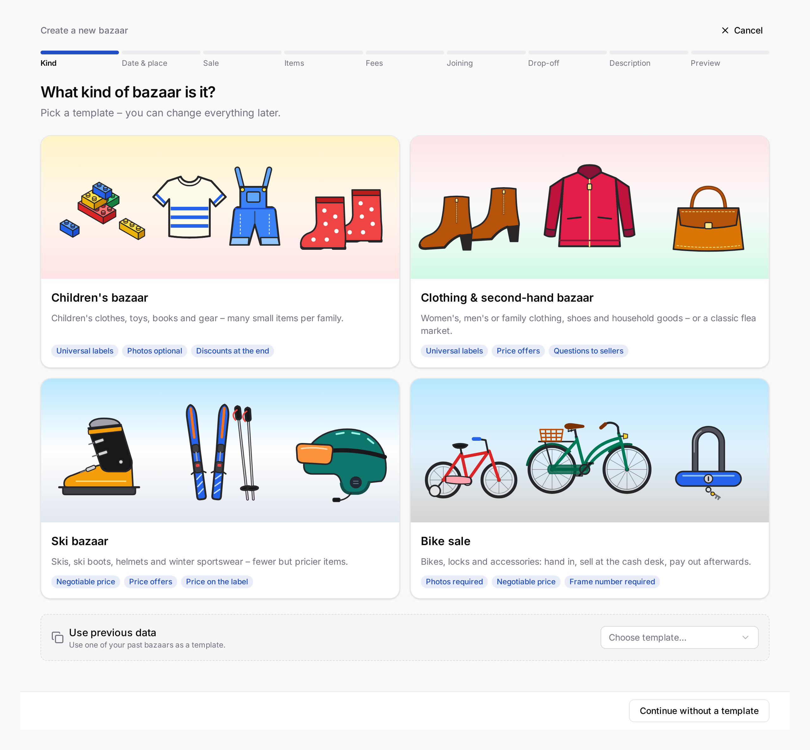
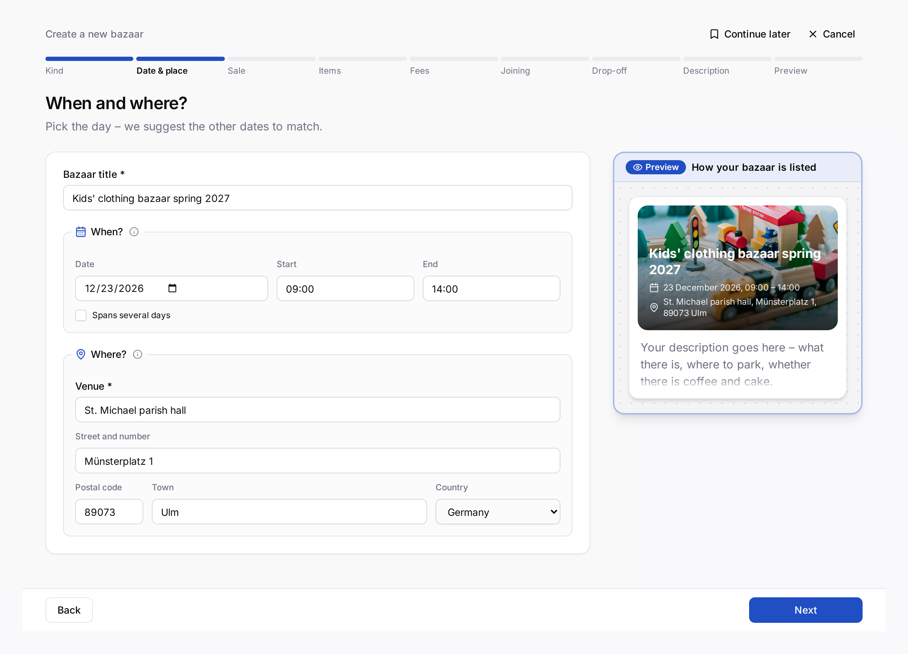
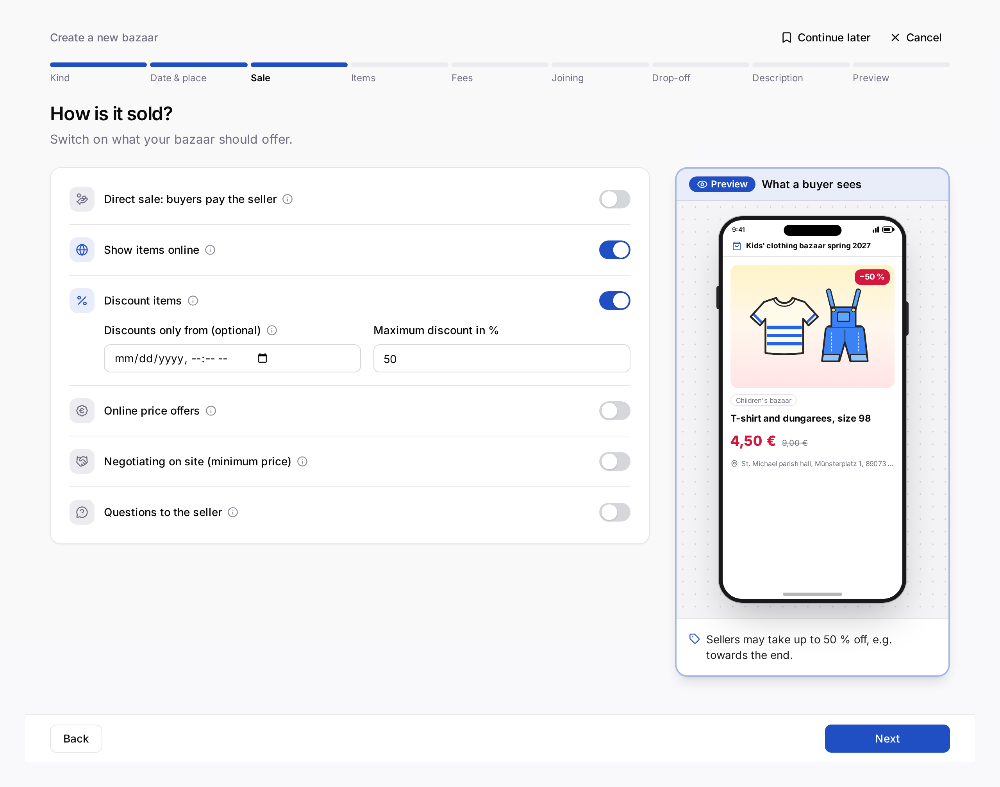
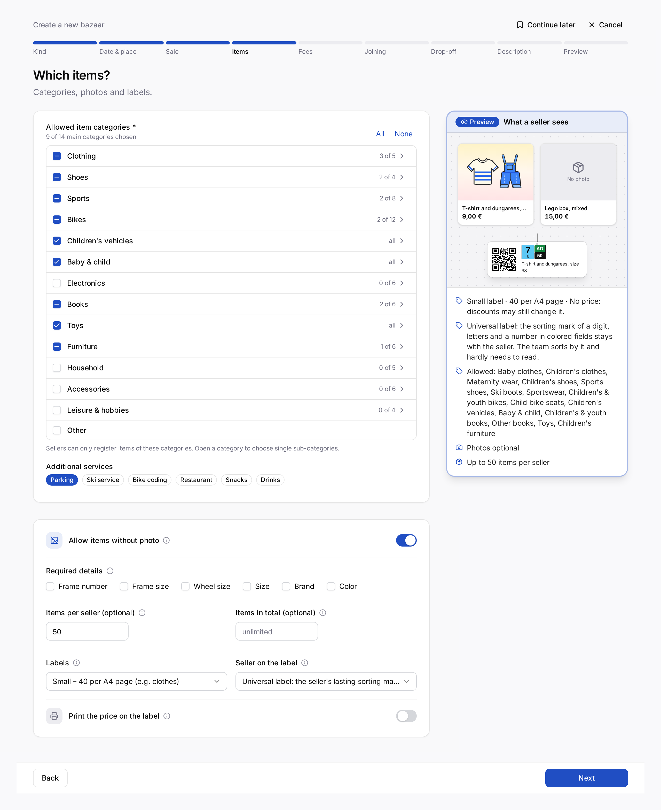
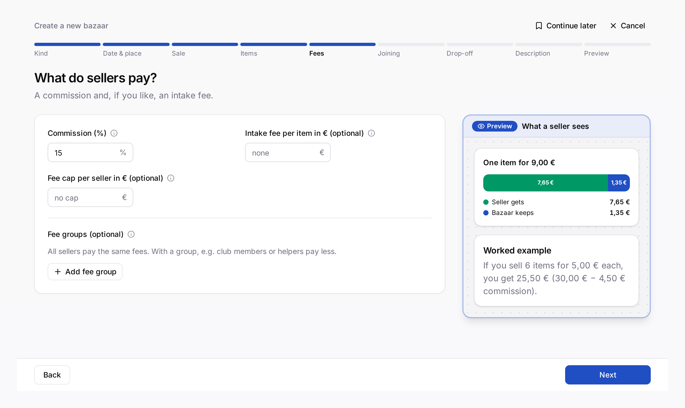
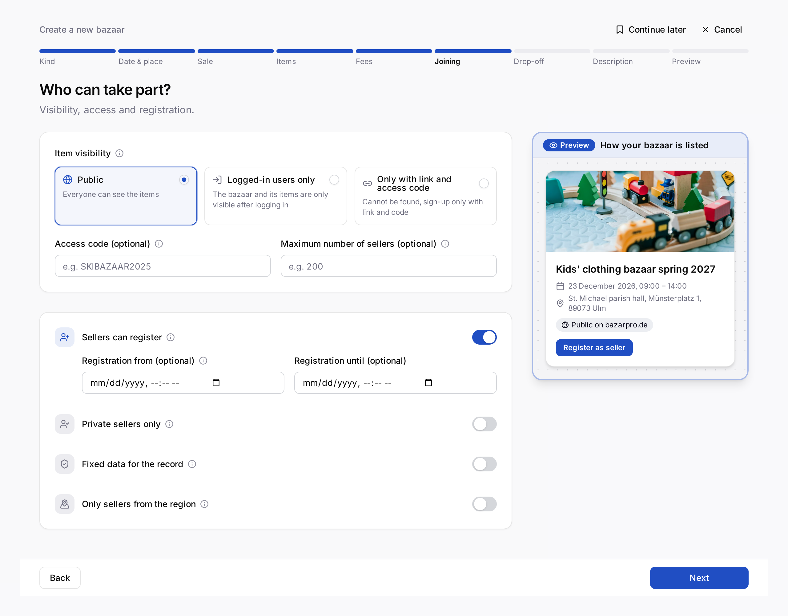
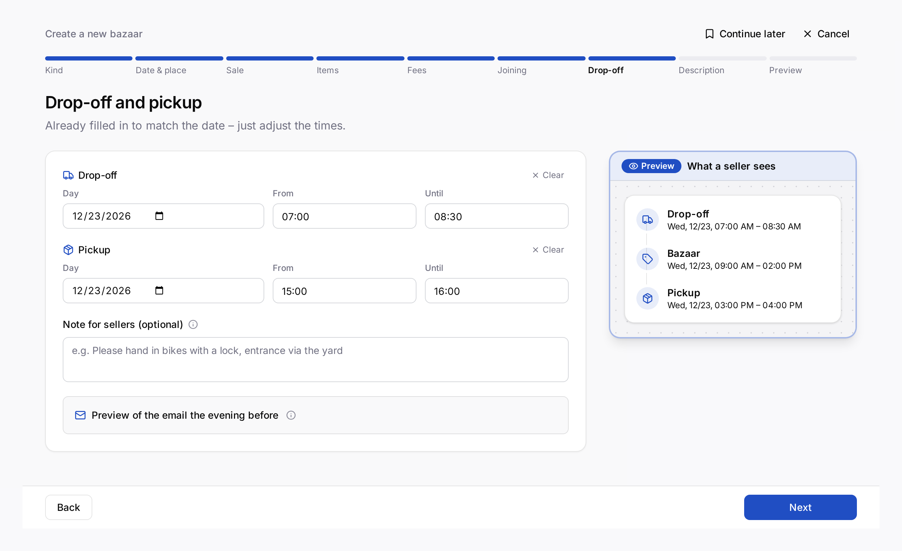
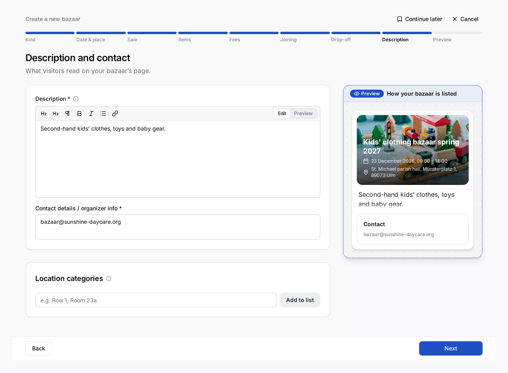
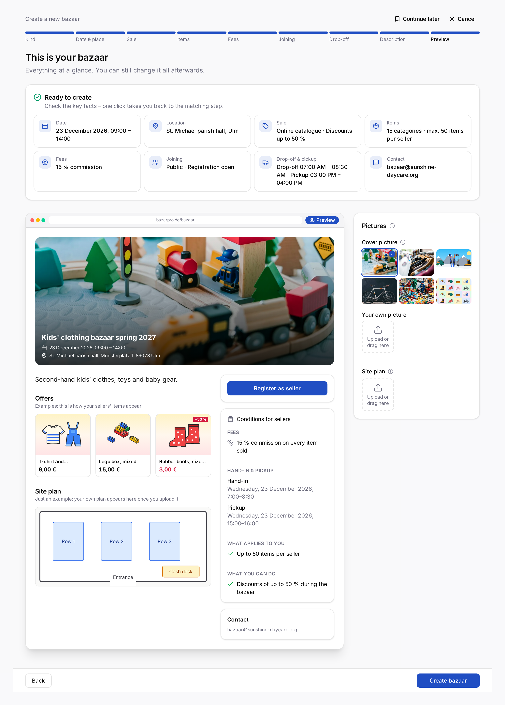

import { Aside, LinkCard, Steps } from '@astrojs/starlight/components';

In this guide you create a bazaar. A wizard takes you through all settings in nine steps and explains at each step what they mean for your sellers. Allow about ten minutes.

**You need:** a BazarPro account. Don't have one yet? [Sign up as an organizer for free](https://bazarpro.de/register?role=organizer). A cover image and a site map are optional but make your bazaar much more appealing.

## Create the bazaar

<Steps>

1. **Switch to the “Organize” area.** At the top of the sidebar, click **Organize**.

2. **Open “New bazaar”.** Under **All bazaars**, click **New bazaar**.

   

3. **Pick the kind of bazaar.** The kind presets suitable settings. You can change everything in the following steps.

   

   | Kind | Presets |
   | --- | --- |
   | **Children's bazaar** | Small [universal labels](/en/veranstalter/universal-etiketten/), photos optional, 50 items per seller, discounts, 15 % commission |
   | **Clothing & second-hand bazaar** | Small [universal labels](/en/veranstalter/universal-etiketten/), photos optional, 30 items per seller, discounts, price offers and questions, 10 % commission |
   | **Ski bazaar** | Large labels with price, photos optional, 15 items per seller, negotiable prices, price offers and questions, 10 % commission |
   | **Bike sale** | Large labels with price, photos required, frame number required, negotiable prices, price offers and questions, 10 % commission, €3 intake fee per bike |

   The kinds also preselect suitable categories, for bike sales all categories for bikes and children's vehicles such as balance bikes and scooters, for example. If you have created a bazaar before, you can take over its settings instead. **Continue without a template** starts without presets.

4. **When and where?** Pick the day first. The wizard then suggests the other dates to match, e.g. for discounts, registration, drop-off and pickup.

   

   - **Title** – at least 3 characters, e.g. “Kids' clothing bazaar spring 2027”.
   - **Venue and address** – the venue as precise as possible, e.g. with hall or entrance. With an address, visitors find their way and Google shows your bazaar in its event search. The [region](#only-sellers-from-the-region) also uses the postal code as its centre.
   - **Date, start and end** – the bazaar must start tomorrow at the earliest. You enter times in 24-hour format. If it lasts more than one day, tick **Spans several days** and choose the first and the last day.

   On the right you see how your bazaar appears in the list of bazaars.

5. **How is it sold?** Turn on the features that fit your bazaar. The preview on the right shows what they mean for buyers.

   

   | Feature | What it does |
   | --- | --- |
   | **Show items online** | Visitors see the items online before the bazaar, with price and photos. Switched off, there is no online list; on site the QR label still shows the price. Price offers and questions need the online list. |
   | **Discount items** | Sellers lower their price during the bazaar, at most down to your maximum discount. **Discounts only from** sets from when. |
   | **Online price offers** | Logged-in buyers suggest a price during the bazaar. If the seller accepts, that price applies at the cash desk. |
   | **Negotiating on site (minimum price)** | Sellers set a minimum price that buyers don't see. At the cash desk, the price can be negotiated down to it. |
   | **Questions to the seller** | Buyers ask publicly on the item, and everyone sees the answer. With **Only during the bazaar**, questions are only possible once the bazaar has started. |
   | **Direct sale** | Sellers stand at their own items, see [Direct sale](#direct-sale). |

6. **Which items?**

   

   - **Categories** – sellers can only register items from these categories. Every main category has sub-categories, e.g. **Bikes** with kids' bikes, e-bikes and cargo bikes. Expand a main category to allow only some of its sub-categories. Some categories come with **extra fields**, e.g. frame number, frame size and colour for bikes, or size and brand for clothes.
   - **Additional services** – what else your bazaar offers, e.g. parking, drinks, a ski service or **bike coding**. The services appear on your bazaar page.
   - **Allow items without photo** – useful for many small items, as at a kids' bazaar.
   - **Required details** – extra fields every item must have before it can be registered, e.g. the frame number. If a seller can't find the frame number, **Not found** fills in “not found” the same way for everyone, and you look for it together at the drop-off.
   - **Items per seller** (optional) – so that intake and space are enough.
   - **Items in total** (optional) – limits the items of all sellers together, e.g. to what fits into the hall. Sellers see how many item places are still free when they register. Once all are taken, nobody can register more items.
   - **Labels** – **Large** (12 per A4 page, e.g. for bikes) or **Small** (40 per A4 page, e.g. for clothes). Every label shows the QR code, title and size. Under **Seller on the label** you choose the [universal label](/en/veranstalter/universal-etiketten/) with sorting mark (default) or just the QR code. **Print the price on the label** helps at the cash desk but only works without discounts, because a printed price can't go down.

7. **What do sellers pay?**

   

   - **Commission** – the share of the sale price you keep.
   - **Intake fee per item** (optional) – charged for every accepted item, even if it doesn't sell, e.g. €3 per bike. It is deducted from the payout at settlement.
   - **Fee cap per seller** (optional) – a seller pays at most this much in commission and intake fees altogether, e.g. €20 for expensive bikes. Anything above it is given back at settlement.
   - **Fee groups** (optional) – own fees for a group of sellers, e.g. club members paying 5 % instead of 10 % or helpers without commission. Each group has its own commission, intake fee, cap and, if you like, more **items per seller**. Under **Who belongs to it?** you choose:
     - **Sellers say so when registering** – the seller picks the group. At the drop-off you check the proof you describe in the hint, e.g. “Show your membership card” (see [Intake](/en/veranstalter/basartag/#intake)).
     - **Helpers of the bazaar** – applies automatically to everyone with a helper role. Under **Sellers**, the percent icon also lets you add people without helper rights, e.g. cake donors.

     Who belongs to several groups pays the cheapest fees. Sellers see all groups in the conditions.

   <Aside type="tip" title="Example">
     With 15 % commission and a bike sold for €40.00, the seller gets €34.00 and €6.00 stays with you. With a €3.00 intake fee, they get €31.00. Before they register, sellers see a worked example that fits the kind of bazaar, e.g. a bike for €150 at a bike market or six items for €5 each at a kids' bazaar. It only includes the fees your bazaar actually charges.
   </Aside>

8. **Who can take part?**

   

   **Item visibility** decides who can see your bazaar and its items:

   | Setting | Who sees what? |
   | --- | --- |
   | **Public** | Everyone, even without an account. Your bazaar appears on the home page after a short review. |
   | **Logged-in users only** | The bazaar and its items are only visible after logging in. |
   | **Only with link and access code** | The bazaar does not appear in search, on the home page or in search engines. Anyone with the link sees the bazaar page. Only people with an account who enter the code can register, so the code is required. Only registered sellers, your team and administrators see the items. |

   With an **access code**, only sellers you give the code to can register. The **maximum number of sellers** limits how many can join. You can also [invite individual people by email](/en/veranstalter/basartag/#invite-sellers-and-helpers) later, they then need no code.

   - **Sellers can register** – when off, only people you invite get in. **Registration from** and **Registration until** (both optional) set a window, e.g. from four weeks before the bazaar until three days before. Without them, registration is open right away until the end of the bazaar. Invitations also work outside this window.
   - **Only sellers from the region** – only sellers with a postal code from your areas register by themselves, see [Only sellers from the region](#only-sellers-from-the-region).

   For a record towards the police, there are two more switches:

   - **Private sellers only** – sellers confirm at registration that they don't sell commercially.
   - **Fixed data for the record** – from the first accepted item, the seller's name and address and the title, category, price and required details of every accepted item are fixed.

9. **Drop-off and pickup.** Enter when sellers bring their items and when they pick up unsold items and their money, plus a note like “Entrance through the yard”. The wizard suggests times that fit the date, you only adjust the hours. The times appear in the conditions and in the automatic emails (see below). **Preview of the email the evening before** shows exactly what will be sent. With [direct sale](#direct-sale), the step is called **Setup and teardown**.

   

10. **Description and contact.** Visitors read this on your bazaar page, and the preview on the right grows with it.

    - **Description** – at least 10 characters. You can use headings, lists, **bold**, *italics* and links. **Preview** shows how it looks.
    - **Contact details** – shown to sellers and visitors on your bazaar page.
    - **Location categories** (optional) – like “Hall B” or “Tables 1–10”. At intake you assign each item a location, and visitors see where it is when they scan it.

    

11. **This is your bazaar.** Finally, you see the preview with the key details, contact and the seller conditions. On the right you choose a **cover picture** and can upload a **site plan**. **Create bazaar** creates the bazaar. It appears under **All bazaars** with its state **Upcoming**, **Happening now** or **Ended**.

    

</Steps>

A step only continues once its details are valid. **Back** takes you to the previous step at any time. **Continue later** saves where you are, so you can finish another time.

## Direct sale

At some markets, sellers stand at their own items, e.g. a bike market with stalls. For this, turn on **Direct sale** in the step **How is it sold?**:

- Buyer and seller agree at the item, and the buyer pays the seller directly.
- Then the cash desk scans the label, books the sale at the agreed price and only collects the commission from the seller.
- There is no payout after the market. The cash count shows direct sales separately, and the record still shows every sale.
- The times are called **Setup** and **Teardown** instead of drop-off and pickup, in the conditions, on your bazaar page and in the emails. **Price negotiable** is preselected for new items.

Once sales are booked, direct sale can no longer be turned on or off.

## Only sellers from the region

If your bazaar is meant for, say, families from your town, turn on **Only sellers from the region** in the step **Who can take part?**. On a map of postal code areas you choose the centre (the bazaar's venue or your location), drag the radius and tap single areas on or off. You can also type postal codes or their beginning, e.g. `7322` or `AT-6900`. The region may cross borders.

- Only people whose profile postal code lies in the region register by themselves. Everyone else gets in only with an [invitation](/en/veranstalter/basartag/#invite-sellers-and-helpers), even if the bazaar has an access code.
- Sellers see the region in the conditions and on the map with **View map**.
- Whoever registered through the region can't change postal code and country in their profile until the bazaar ends. Check them with the ID at the drop-off.

## Automatic emails to sellers

Without you having to do anything, BazarPro sends your sellers two emails:

- **The evening before at 6 pm** to everyone with registered items: bazaar time, location, drop-off time, seller number, number of items, a reminder about labels and the digital ID, your note and your contact details.
- **For pickup** to everyone who handed in something and isn't settled yet: what sold, the payout amount and the items to pick up. The email arrives right after the bazaar ends or 2 hours before a later pickup time.

If you move the bazaar, the emails go out again for the new date.

## Changing settings later

Under **Settings** you find all details on one page, in the same sections as in the wizard. A few things are fixed once sellers rely on them:

- **Commission, intake fee and fee cap** can only be lowered after the first registration. **Fee groups** can then only get cheaper and can no longer be removed.
- **Items per seller** can only be raised after the first registration. If you lower **Items in total**, items already registered stay.
- You open and close **registration** at any time under **Sellers** as well, see [Control registration and participation](/en/veranstalter/basartag/#control-registration-and-participation).
- **During the bazaar**, dates, commission and visibility are locked so that settlement and approval stay correct.

## Approval of public bazaars

So that only real bazaars appear on the public home page, an administrator reviews every **public** bazaar before it becomes visible. Until then, only you can see it. Bazaars set to **Logged-in users only** or **Only with link and access code** are active immediately.

If you later change the visibility of an existing bazaar to **Public**, it is reviewed again.

<Aside type="caution">
  If the **New bazaar** button is missing, creating bazaars is currently disabled on this BazarPro instance. Contact the operator.
</Aside>

## What's next?

Spread the word with posters, flyers and pictures for social media, see [Promotion](/en/veranstalter/basartag/#promotion). Share the link to your bazaar with your sellers – and the access code, if you use one. You can also [invite individual people by email](/en/veranstalter/basartag/#invite-sellers-and-helpers). How sellers register and list their items is described in [List an item](/en/verkaeufer/artikel-inserieren/). How intake, cash desk and settlement work is described in [The bazaar day](/en/veranstalter/basartag/).

<LinkCard
  title="Create your bazaar for free"
  description="Sign up at bazarpro.de and set up your bazaar in ten minutes – no commission for BazarPro, no subscription."
  href="https://bazarpro.de/register?role=organizer"
/>
