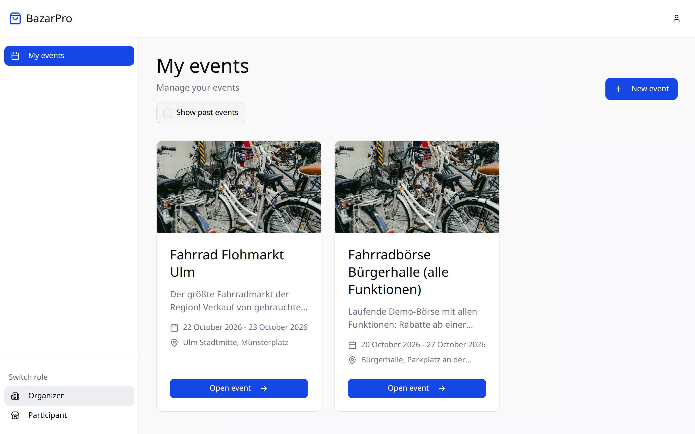
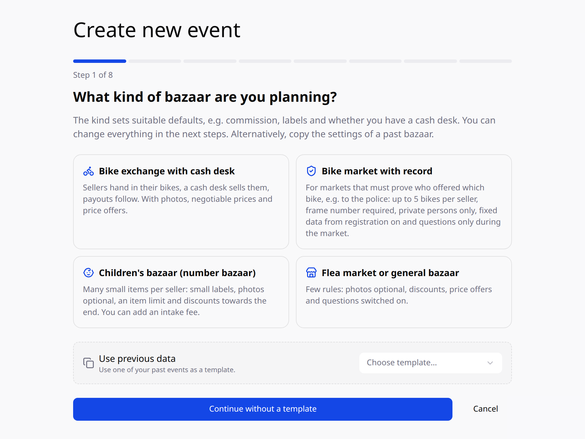
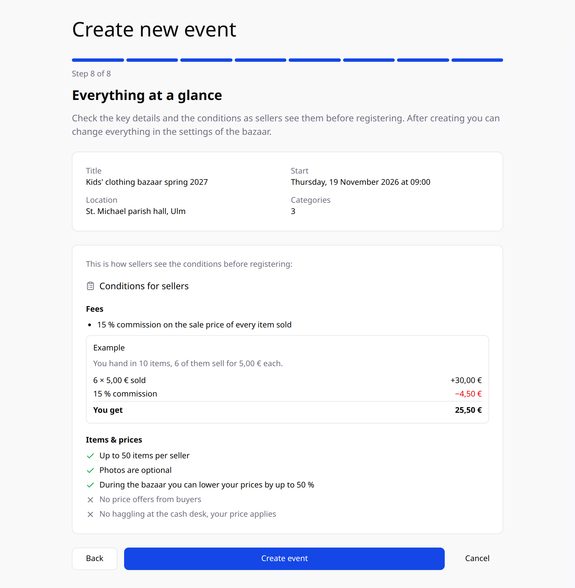

import { Aside, LinkCard, Steps } from '@astrojs/starlight/components';

In this guide you create a bazaar. A wizard takes you through all settings in eight steps and explains at each step what they mean for your sellers. Allow about ten minutes.

**You need:** a BazarPro account. Don't have one yet? [Sign up as an organizer for free](https://bazarpro.de/register?role=organizer). A cover image and a site map are optional but make your bazaar much more appealing.

## Create the bazaar

<Steps>

1. **Switch to the “Organizer” role.** At the bottom of the sidebar, under **Switch role**, click **Organizer**.

2. **Open “New event”.** Under **My events**, click **New event**.

   

3. **Pick the kind of bazaar.** The kind presets suitable settings. You can change everything in the following steps.

   

   | Kind | Presets |
   | --- | --- |
   | **Bike exchange with cash desk** | Photos, negotiable prices, price offers, large labels with price, 10 % commission |
   | **Bike market with record** | For markets that must show who offered which bike, e.g. to the police: at most 5 bikes per seller, frame number required, private sellers only, fixed data, questions only during the market, 20 % commission |
   | **Children's bazaar (number bazaar)** | Small labels, photos optional, 50 items per seller, discounts, 15 % commission |
   | **Flea market or general bazaar** | Few rules: photos optional, discounts, price offers and questions, 10 % commission |

   The kinds also preselect suitable categories, for bike sales all bike categories, for example. If you have created a bazaar before, you can take over its settings instead. **Continue without a template** starts without presets.

4. **When and where?** Title, description, date and location appear on the bazaar page and in the emails to sellers.

   - **Title** – at least 3 characters, e.g. “Kids' clothing bazaar spring 2027”.
   - **Description** – at least 10 characters. You can use headings, lists, **bold**, *italics* and links. **Preview** shows how it looks.
   - **Location** – as precise as possible, e.g. with hall or entrance.
   - **Start and end date** – the bazaar must start tomorrow at the earliest.
   - **Cover image and site map** (optional) – For the site map, you add **location categories** like “Hall B” or “Tables 1–10”. At intake you assign each item a location, and visitors see where it is when they scan it.

5. **How are items sold?** Turn on the features that fit your bazaar:

   | Feature | What it does |
   | --- | --- |
   | **Discount items** | Sellers lower their price during the bazaar, from a time you set and at most down to your maximum discount. |
   | **Online price offers** | Logged-in buyers suggest a price during the bazaar. If the seller accepts, that price applies at the cash desk. |
   | **Negotiating on site (minimum price)** | Sellers set a minimum price that buyers don't see. At the cash desk, the price can be negotiated down to it. |
   | **Questions to the seller** | Buyers ask publicly on the item, and everyone sees the answer. With **Only during the bazaar**, questions are only possible once the bazaar has started. |

6. **What does it cost sellers?**

   - **Commission** – the share of the sale price you keep.
   - **Intake fee per item** (optional) – charged for every accepted item, even if it doesn't sell, e.g. €3 per bike. It is deducted from the payout at settlement.
   - **Contact details** – shown to sellers and visitors on your bazaar page.

   <Aside type="tip" title="Example">
     With 15 % commission and a bike sold for €40.00, the seller gets €34.00 and €6.00 stays with you. With a €3.00 intake fee, they get €31.00. Sellers see this calculation as an example before they register.
   </Aside>

7. **Which items?**

   - **Categories** – sellers can only offer items from these categories. Some categories come with **extra fields**, e.g. frame number and frame size for bikes, or size and brand for clothes.
   - **Required details** – extra fields every item must have before it can be registered, e.g. the frame number.
   - **Allow items without photo** – useful for many small items, as at a kids' bazaar.
   - **Items per seller** (optional) – so that intake and space are enough.
   - **Labels** – **Large** (12 per A4 page, e.g. for bikes) or **Small** (40 per A4 page, e.g. for clothes). Every label shows the QR code, seller number, title and size. **Print the price on the label** helps at the cash desk but only works without discounts, because a printed price can't go down.

8. **Who may take part?**

   **Item visibility** decides who can see the items of your bazaar:

   | Setting | Who sees the items? |
   | --- | --- |
   | **Public** | Everyone, even without an account. Your bazaar appears on the home page after a short review. |
   | **Logged-in users only** | Only visitors with a BazarPro account. |
   | **Approved users only** | Only users who have been explicitly approved. |

   With an **access code**, only sellers you give the code to can register. The **maximum number of sellers** limits how many can join.

   For a record towards the police, there are two more switches:

   - **Private sellers only** – sellers confirm at registration that they don't sell commercially.
   - **Fixed data for the record** – from the first registered item, the seller's name and address and the item's title, category, price and required details are fixed. Withdrawing items is only possible until the bazaar starts.

9. **Hand-in and pickup.** Enter when sellers bring their items and when they pick up unsold items and their money, plus a note like “Entrance through the yard”. The times appear in the conditions and in the automatic emails (see below). **Preview of the email the evening before** shows exactly what will be sent.

10. **Everything at a glance.** Finally, you see the key details and the conditions exactly as sellers see them before registering, with a worked example. **Create event** creates the bazaar. It appears under **My events**.

    

</Steps>

A step only continues once its details are valid. **Back** takes you to the previous step at any time.

## Automatic emails to sellers

Without you having to do anything, BazarPro sends your sellers two emails:

- **The evening before at 6 pm** to everyone with registered items: bazaar time, location, drop-off time, seller number, number of items, a reminder about labels and the digital ID, your note and your contact details.
- **For pickup** to everyone who handed in something and isn't settled yet: what sold, the payout amount and the items to pick up. The email arrives right after the bazaar ends or 2 hours before a later pickup time.

If you move the bazaar, the emails go out again for the new date.

## Changing settings later

Under **Edit settings** you find all details in one form. A few things are fixed once sellers rely on them:

- **Commission and intake fee** can only be lowered after the first registration.
- **Items per seller** can only be raised after the first registration.
- **During the bazaar**, dates, commission and visibility are locked so that settlement and approval stay correct.

## Approval of public bazaars

So that only real bazaars appear on the public home page, an administrator reviews every **public** bazaar before it becomes visible. Until then, only you can see it. Bazaars set to **Logged-in users only** or **Approved users only** are active immediately.

If you later change the visibility of an existing bazaar to **Public**, it is reviewed again.

<Aside type="caution">
  If the **New event** button is missing, creating bazaars is currently disabled on this BazarPro instance. Contact the operator.
</Aside>

## What's next?

Share the link to your bazaar with your sellers – and the access code, if you use one. How sellers register and list their items is described in [List an item](/en/verkaeufer/artikel-inserieren/). How intake, cash desk and settlement work is described in [The bazaar day](/en/veranstalter/basartag/).

<LinkCard
  title="Create your bazaar for free"
  description="Sign up at bazarpro.de and set up your bazaar in ten minutes – no commission for BazarPro, no subscription."
  href="https://bazarpro.de/register?role=organizer"
/>
