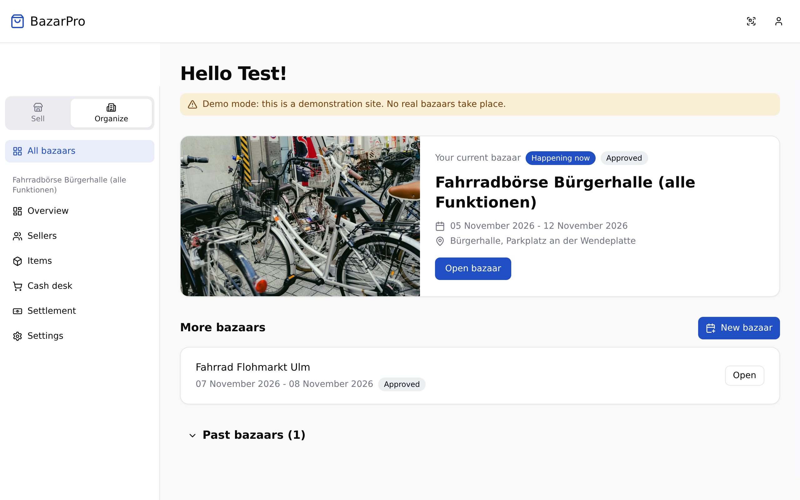
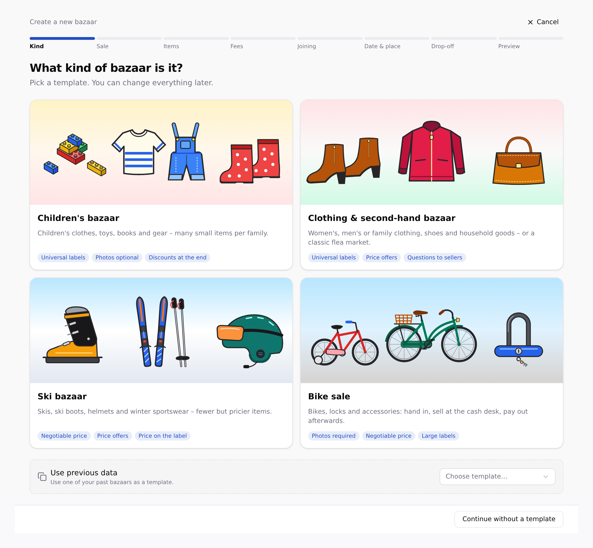
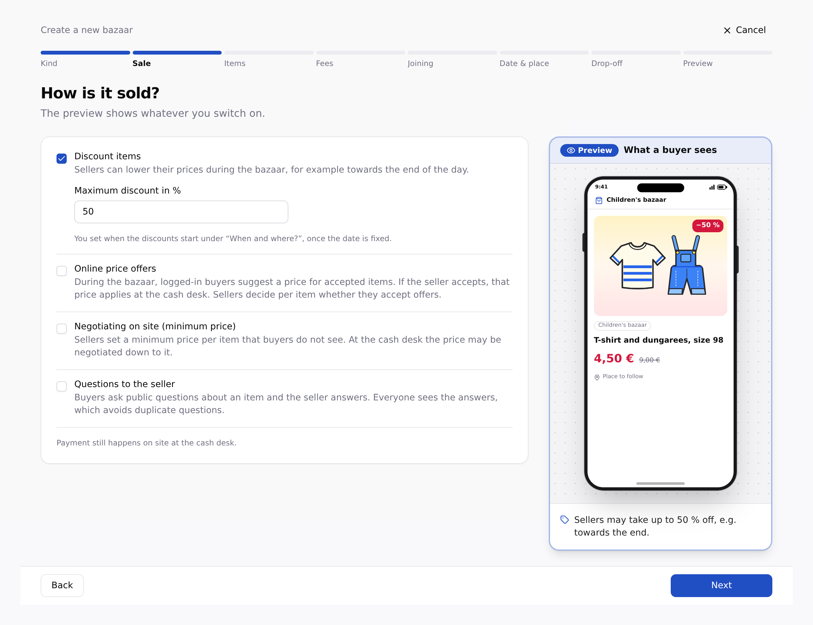
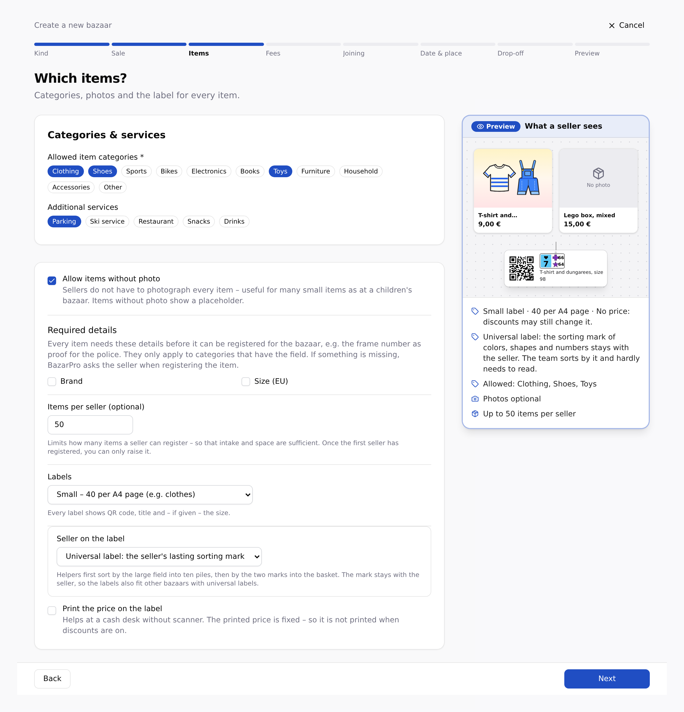
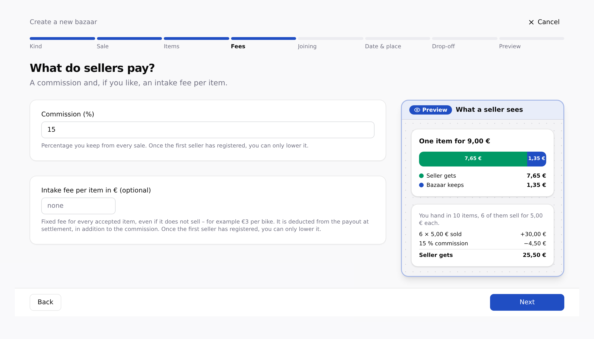
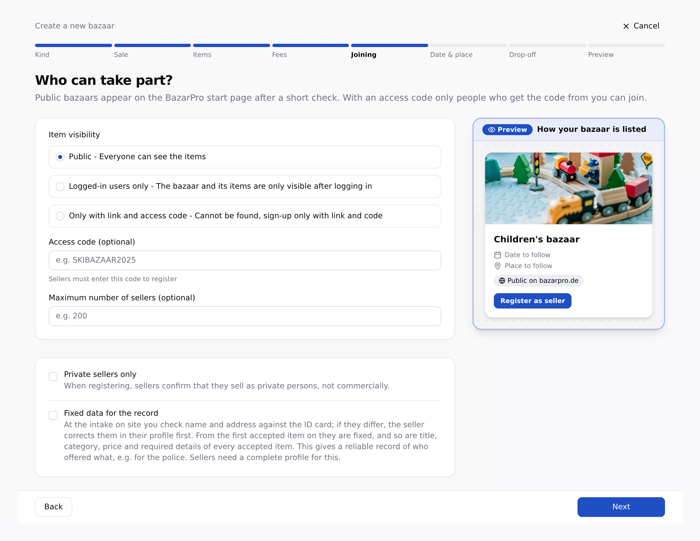
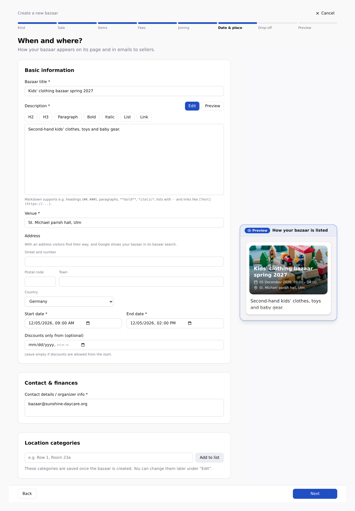
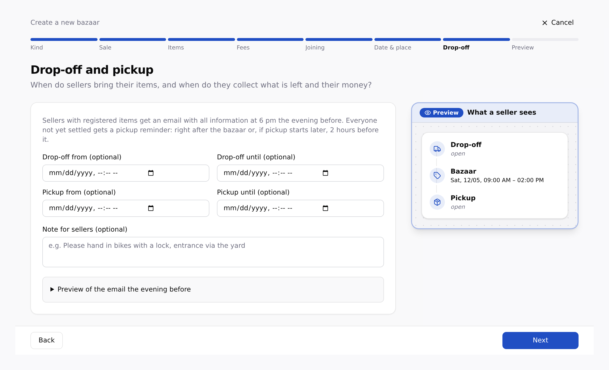
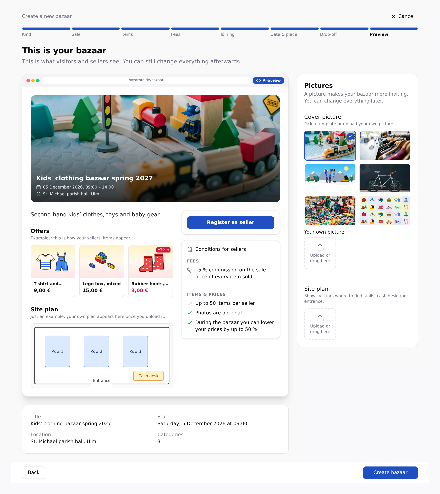

import { Aside, LinkCard, Steps } from '@astrojs/starlight/components';

In this guide you create a bazaar. A wizard takes you through all settings in eight steps and explains at each step what they mean for your sellers. Allow about ten minutes.

**You need:** a BazarPro account. Don't have one yet? [Sign up as an organizer for free](https://bazarpro.de/register?role=organizer). A cover image and a site map are optional but make your bazaar much more appealing.

## Create the bazaar

<Steps>

1. **Switch to the “Organize” area.** At the top of the sidebar, click **Organize**.

2. **Open “New bazaar”.** Under **All bazaars**, click **New bazaar**.

   

3. **Pick the kind of bazaar.** The kind presets suitable settings. You can change everything in the following steps.

   

   | Kind | Presets |
   | --- | --- |
   | **Children's bazaar** | Small [universal labels](/en/veranstalter/universal-etiketten/), photos optional, 50 items per seller, discounts, 15 % commission |
   | **Clothing & second-hand bazaar** | Small [universal labels](/en/veranstalter/universal-etiketten/), photos optional, 30 items per seller, discounts, price offers and questions, 10 % commission |
   | **Ski bazaar** | Large labels with price, photos optional, 15 items per seller, negotiable prices, price offers and questions, 10 % commission |
   | **Bike sale** | Large labels with price, photos required, negotiable prices, price offers and questions, 10 % commission |

   The kinds also preselect suitable categories, for bike sales all bike categories, for example. If you have created a bazaar before, you can take over its settings instead. **Continue without a template** starts without presets.

4. **How is it sold?** Turn on the features that fit your bazaar. The preview on the right shows what they mean for buyers.

   

   | Feature | What it does |
   | --- | --- |
   | **Discount items** | Sellers lower their price during the bazaar, at most down to your maximum discount. You set from when under “When and where?”. |
   | **Online price offers** | Logged-in buyers suggest a price during the bazaar. If the seller accepts, that price applies at the cash desk. |
   | **Negotiating on site (minimum price)** | Sellers set a minimum price that buyers don't see. At the cash desk, the price can be negotiated down to it. |
   | **Questions to the seller** | Buyers ask publicly on the item, and everyone sees the answer. With **Only during the bazaar**, questions are only possible once the bazaar has started. |

5. **Which items?**

   

   - **Categories** – sellers can only offer items from these categories. Some categories come with **extra fields**, e.g. frame number and frame size for bikes, or size and brand for clothes.
   - **Allow items without photo** – useful for many small items, as at a kids' bazaar.
   - **Required details** – extra fields every item must have before it can be registered, e.g. the frame number.
   - **Items per seller** (optional) – so that intake and space are enough.
   - **Labels** – **Large** (12 per A4 page, e.g. for bikes) or **Small** (40 per A4 page, e.g. for clothes). Every label shows the QR code, title and size. Under **Seller on the label** you choose the [universal label](/en/veranstalter/universal-etiketten/) with sorting mark (default) or just the QR code. **Print the price on the label** helps at the cash desk but only works without discounts, because a printed price can't go down.

6. **What do sellers pay?**

   

   - **Commission** – the share of the sale price you keep.
   - **Intake fee per item** (optional) – charged for every accepted item, even if it doesn't sell, e.g. €3 per bike. It is deducted from the payout at settlement.

   <Aside type="tip" title="Example">
     With 15 % commission and a bike sold for €40.00, the seller gets €34.00 and €6.00 stays with you. With a €3.00 intake fee, they get €31.00. Sellers see this calculation as an example before they register.
   </Aside>

7. **Who can take part?**

   

   **Item visibility** decides who can see your bazaar and its items:

   | Setting | Who sees what? |
   | --- | --- |
   | **Public** | Everyone, even without an account. Your bazaar appears on the home page after a short review. |
   | **Logged-in users only** | The bazaar and its items are only visible after logging in. |
   | **Only with link and access code** | The bazaar does not appear in search, on the home page or in search engines. Anyone with the link sees the bazaar page. Only people with an account who enter the code can register, so the code is required. Only registered sellers, your team and administrators see the items. |

   With an **access code**, only sellers you give the code to can register. The **maximum number of sellers** limits how many can join. You can also [invite individual people by email](/en/veranstalter/basartag/#invite-sellers-and-helpers) later, they then need no code.

   For a record towards the police, there are two more switches:

   - **Private sellers only** – sellers confirm at registration that they don't sell commercially.
   - **Fixed data for the record** – from the first accepted item, the seller's name and address and the title, category, price and required details of every accepted item are fixed.

8. **When and where?** These details appear on the bazaar page and in the emails to sellers.

   

   - **Title** – at least 3 characters, e.g. “Kids' clothing bazaar spring 2027”.
   - **Description** – at least 10 characters. You can use headings, lists, **bold**, *italics* and links. **Preview** shows how it looks.
   - **Venue and address** – the venue as precise as possible, e.g. with hall or entrance. With an address, visitors find their way and Google shows your bazaar in its event search.
   - **Start and end date** – the bazaar must start tomorrow at the earliest.
   - **Discounts only from** (optional) – appears if you turned on discounts.
   - **Contact details** – shown to sellers and visitors on your bazaar page.
   - **Location categories** (optional) – like “Hall B” or “Tables 1–10”. At intake you assign each item a location, and visitors see where it is when they scan it.

9. **Drop-off and pickup.** Enter when sellers bring their items and when they pick up unsold items and their money, plus a note like “Entrance through the yard”. The times appear in the conditions and in the automatic emails (see below). **Preview of the email the evening before** shows exactly what will be sent.

   

10. **This is your bazaar.** Finally, you see the preview with the key details and the seller conditions. On the right you choose a **cover picture** and can upload a **site plan**. **Create bazaar** creates the bazaar. It appears under **All bazaars**.

    

</Steps>

A step only continues once its details are valid. **Back** takes you to the previous step at any time.

## Automatic emails to sellers

Without you having to do anything, BazarPro sends your sellers two emails:

- **The evening before at 6 pm** to everyone with registered items: bazaar time, location, drop-off time, seller number, number of items, a reminder about labels and the digital ID, your note and your contact details.
- **For pickup** to everyone who handed in something and isn't settled yet: what sold, the payout amount and the items to pick up. The email arrives right after the bazaar ends or 2 hours before a later pickup time.

If you move the bazaar, the emails go out again for the new date.

## Changing settings later

Under **Settings** you find all details on one page, in the same sections as in the wizard. A few things are fixed once sellers rely on them:

- **Commission and intake fee** can only be lowered after the first registration.
- **Items per seller** can only be raised after the first registration.
- **During the bazaar**, dates, commission and visibility are locked so that settlement and approval stay correct.

## Approval of public bazaars

So that only real bazaars appear on the public home page, an administrator reviews every **public** bazaar before it becomes visible. Until then, only you can see it. Bazaars set to **Logged-in users only** or **Only with link and access code** are active immediately.

If you later change the visibility of an existing bazaar to **Public**, it is reviewed again.

<Aside type="caution">
  If the **New bazaar** button is missing, creating bazaars is currently disabled on this BazarPro instance. Contact the operator.
</Aside>

## What's next?

Share the link to your bazaar with your sellers – and the access code, if you use one. You can also [invite individual people by email](/en/veranstalter/basartag/#invite-sellers-and-helpers). How sellers register and list their items is described in [List an item](/en/verkaeufer/artikel-inserieren/). How intake, cash desk and settlement work is described in [The bazaar day](/en/veranstalter/basartag/).

<LinkCard
  title="Create your bazaar for free"
  description="Sign up at bazarpro.de and set up your bazaar in ten minutes – no commission for BazarPro, no subscription."
  href="https://bazarpro.de/register?role=organizer"
/>
