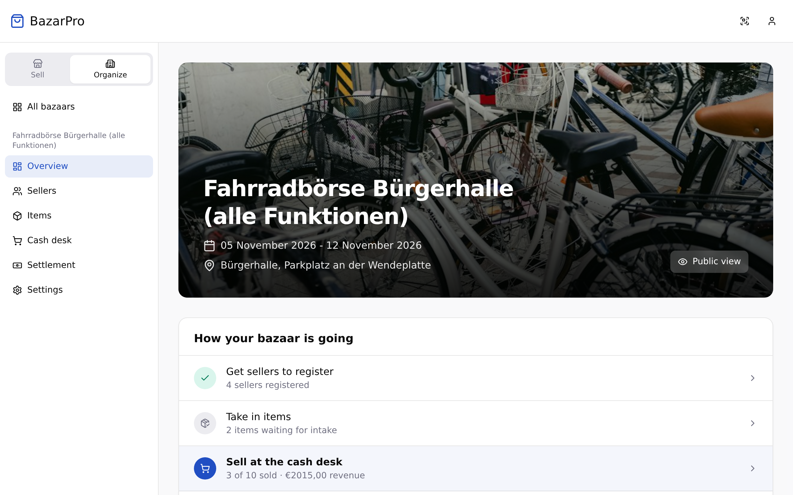
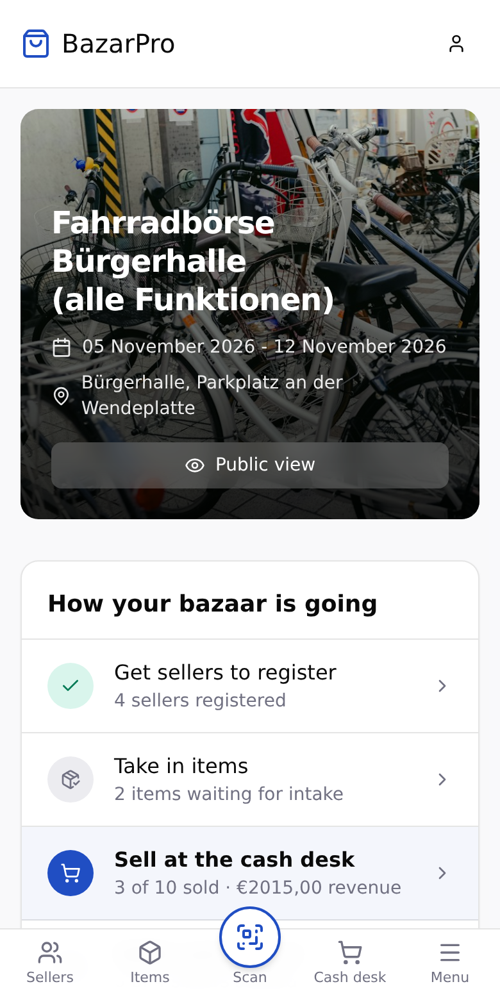
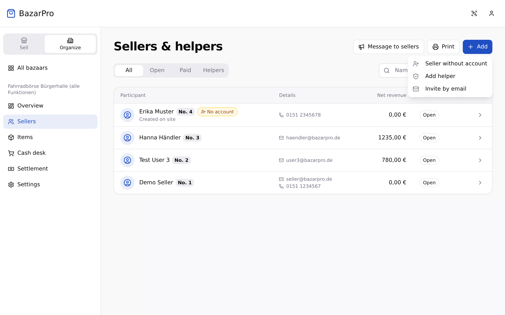
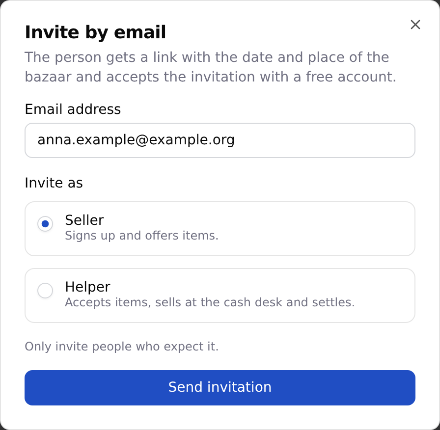
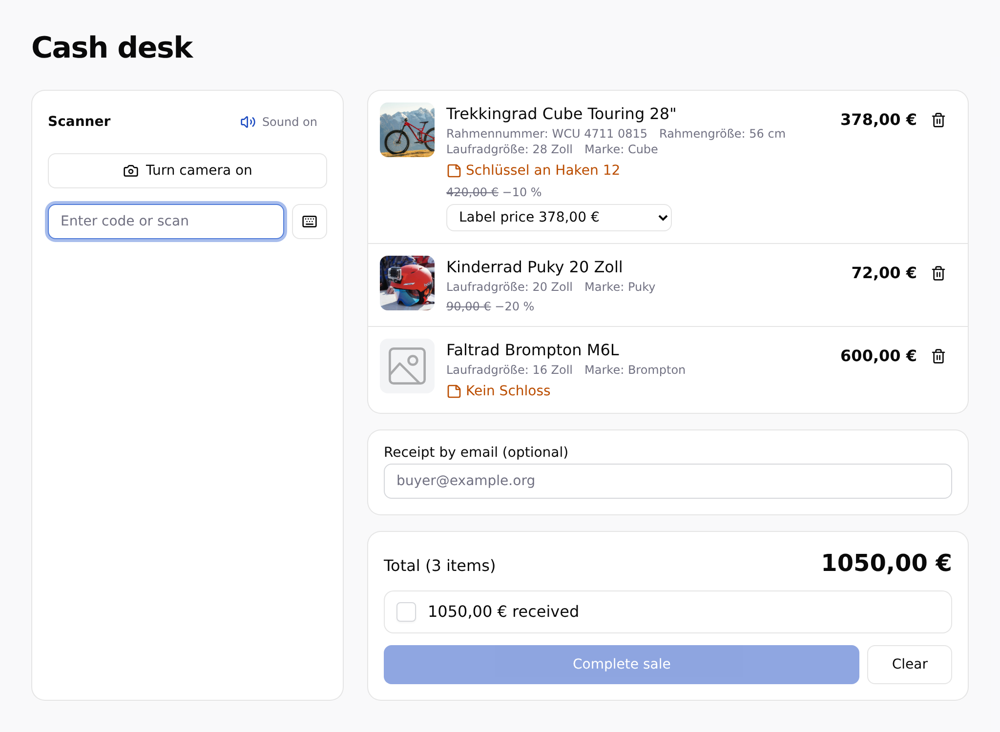
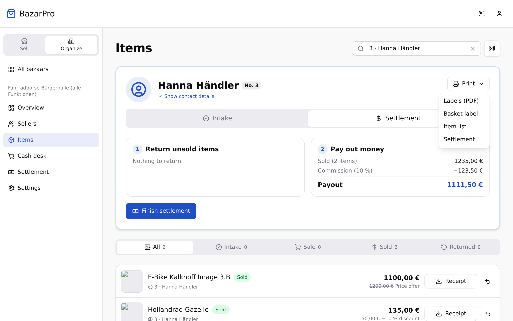

import { Aside, LinkCard, Steps } from '@astrojs/starlight/components';
import { Image } from 'astro:assets';
import settlementPdf from '../../../../assets/ausdrucke/en/abrechnung.png';

This page shows what you do in BazarPro before, during and after the bazaar. How to plan and advertise the bazaar is covered in the guides for a [bike sale](/en/ratgeber/fahrradboerse-organisieren/), a [kids' bazaar](/en/ratgeber/kinderbasar-organisieren/) and a [ski swap](/en/ratgeber/skibasar-organisieren/).

## Your bazaar's overview

Under **Overview**, **How your bazaar is going** shows the way through the bazaar and highlights the step that is due: getting sellers to register, taking in items, selling at the cash desk and so on. One click takes you to the right page.

On phones the menu is a bar at the bottom. **Scan** in the middle opens the scanner, which takes you straight to labels and IDs.

## Before: inform sellers and assign helpers

### Invite sellers and helpers

Under **Sellers**, choose **Add** and then **Invite by email**. This is up to the organizer, helpers don't see it.

<Steps>

1. **Enter address and role.** Enter the email address and choose **Seller** or **Helper**. Only invite people who expect it.

   

2. **Send the invitation.** The person gets an email with a link and the date and place of the bazaar.

3. **Let them accept.** They accept the invitation with a free account. The link only works for the account with the invited address. They need no access code.

</Steps>

Open invitations are listed on the same page, where you can also withdraw them. At most **30 invitations in 24 hours** go out per bazaar. Once the bazaar has ended, no more can be sent.

### Messages and helpers

**Message to sellers.** Under **Sellers**, **Message to sellers** writes to all your sellers at once, for example “Drop-off only from 9 am”. You choose who gets it: all sellers, only those with handed-in items, or only those who still have items to pick up. The message is sent by email and appears on the sellers' bazaar page.

- Up to **5 messages per bazaar and day**.
- Messages marked **Important** also reach sellers who have unsubscribed from organizer messages. One of those is possible per day.

BazarPro sends the email the evening before and the pickup reminder by itself, see [Automatic emails to sellers](/en/veranstalter/basar-anlegen/#automatic-emails-to-sellers).

**Helpers.** Under **Sellers**, **Make helper** turns sellers into helpers, or **Add** and **Add helper** let you search by name, email or number. Helpers need their own account. They can accept items, sell at the cash desk, settle up and print QR codes and invoices. They can't change settings or delete the bazaar.

## Intake

Intake happens under **Items** in your bazaar.

<Steps>

1. **Scan a label or ID.** **Scan QR code** scans an item's label or a seller's **digital ID**. With the ID, you see all registered items of that seller.

2. **Accept.** Accept single items with **Accept**, or all items of a seller at once with **Accept all**. You can assign a **location** and add an **internal note**, such as “Key on hook 12”. Only you and your helpers see the note.

3. **Print missing labels.** **Labels (PDF)** prints a seller's labels right at intake.

</Steps>

From intake on, an item is **Available** and locked for the seller.

**Search by number:** Type “17”, “Nr. 17” or “#17” into the search field to see exactly the items of seller 17.

**Walk-in sellers without an account** are added under **Sellers** with **Add** and **Seller without account**. Under **Items**, **Add item** records their items, and **Save & next** lets you enter many in a row. As long as nothing is sold, you can edit or delete these items.

## Cash desk

Open the **Cash desk** in your bazaar's menu. It is made for all items of one buyer:

<Steps>

1. **Scan items.** With the phone camera (via **Turn camera on**), with a **hand scanner** (it types the code into the field) or by typing. Each item lands in the cart only once, even if the camera recognizes a label several times. A beep confirms every scan.

2. **Check prices.** Each line shows the current price including discounts. If the seller accepted a price offer or set a minimum price, you choose the price.

3. **Take payment and complete.** Confirm the amount received and click **Complete sale**. If the buyer gives their email address, they get **one** receipt for the whole purchase. Every seller gets an email about their sold items.

</Steps>

<Aside type="caution" title="Items marked in red">
  If an item is already sold (e.g. at another cash desk), not accepted, or doesn't belong to your bazaar, the cash desk marks it in red. Remove it from the cart, then you can complete the sale. It's always all or nothing.
</Aside>

## Settlement and return

With [universal labels](/en/veranstalter/universal-etiketten/#sorting-items-back), first sort the unsold items into ten piles and then into the baskets. Print the matching **Sorting sheets** for the baskets under **Sellers**.

After the sale, scan the seller's **digital ID** under **Items**. Under **Settlement** you see:

- the sold items, the **commission** and the **intake fee**,
- the **payout**, or – if the intake fee is higher than the sales – the amount the seller pays (**Collect intake fee**),
- the unsold items that go back.

**Finish settlement** confirms the payout and the return. Afterwards, sales and returns of this seller are locked. If something is wrong after all, **Undo settlement** reopens it – take the paid-out money back so that the cash adds up.

## Printouts for a seller

Sellers without an account in particular can't see their items and settlement online. In a seller's details under **Items** there are two printouts as PDF:

- **Print item list** – all of the seller's items with name, category, details such as size or frame number, price and status: sold with the price achieved, not sold, not handed in or returned.
- **Print settlement** (on the **Settlement** tab) – revenue, commission, intake fee and payout with the same amounts as on screen, followed by the same item list. It also shows whether the seller is settled yet.

<Image src={settlementPdf} alt="“Settlement” printout with seller, revenue, commission, payout and the item list" />

## Settlement of the bazaar

**Settlement** in the menu shows how much cash should be in the till now and how it splits up: payouts still open, commission and intake fees. It also shows how many sellers are settled and who still has to pay an intake fee.

## Record of offered items

Under **Settlement**, **Record as PDF** or **As spreadsheet (CSV)** downloads a list of all registered items: seller number, name, address, contact, item with details such as the frame number, price, and whether and when it was sold. If **Fixed data for the record** is on, the details are taken from the time of registration – later profile changes don't change the record.

<Aside type="caution">
  The file contains personal data. Only pass it on when necessary, for example to the police, and delete it when you no longer need it.
</Aside>

## No bazaar yet?

Intake, cash desk and settlement in BazarPro are **free** – for organizers, sellers and buyers.

<LinkCard
  title="Create your bazaar for free"
  description="Sign up at bazarpro.de and set up your bazaar in ten minutes – no commission for BazarPro, no subscription."
  href="https://bazarpro.de/register?role=organizer"
/>
