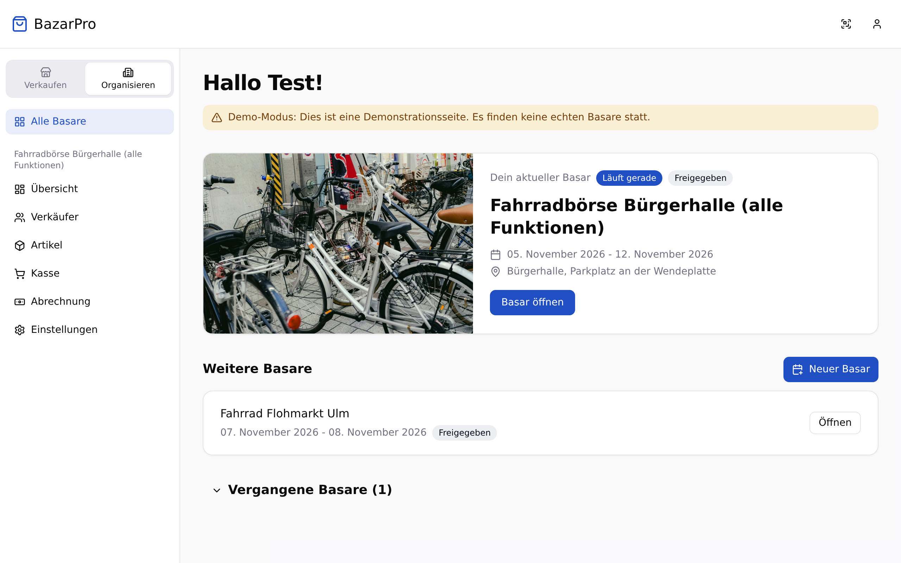
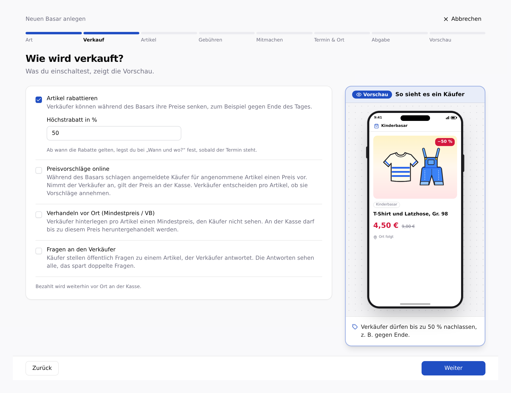
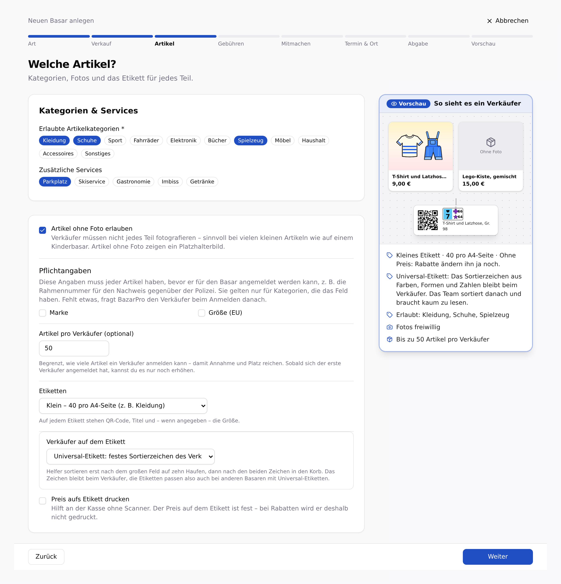
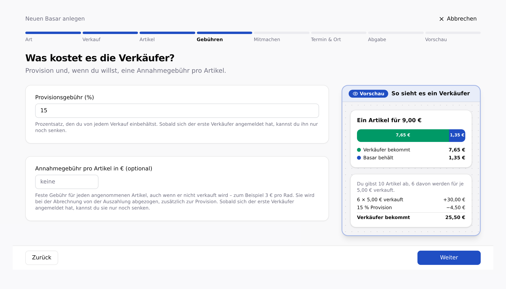
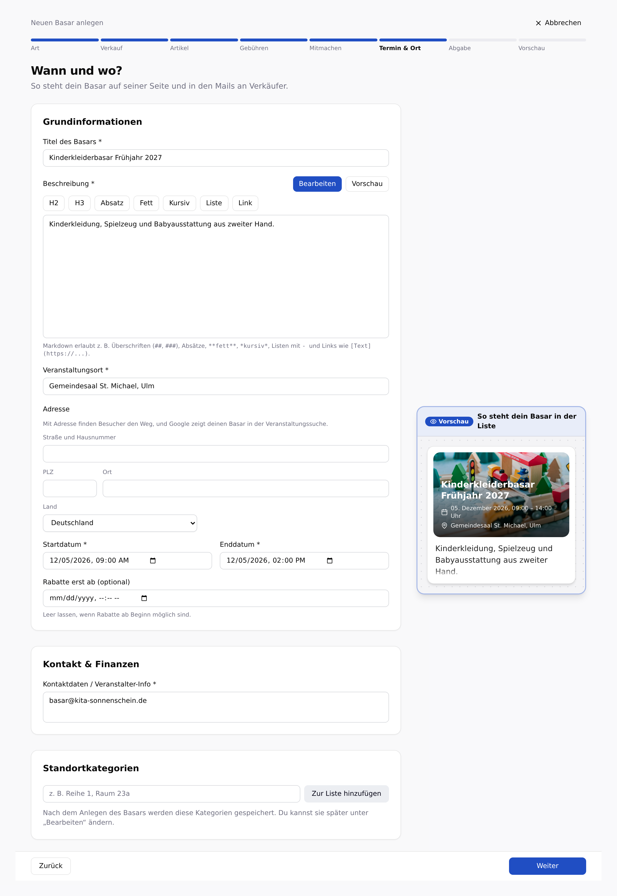
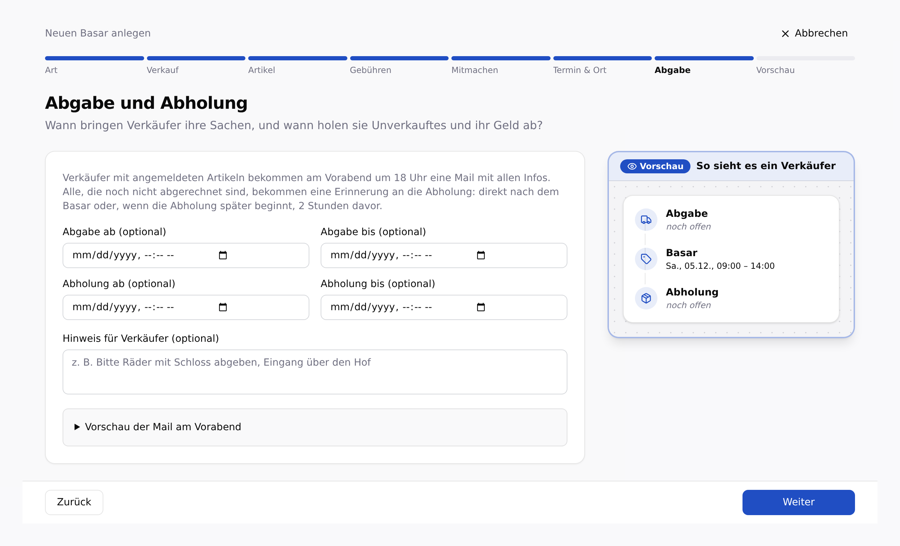
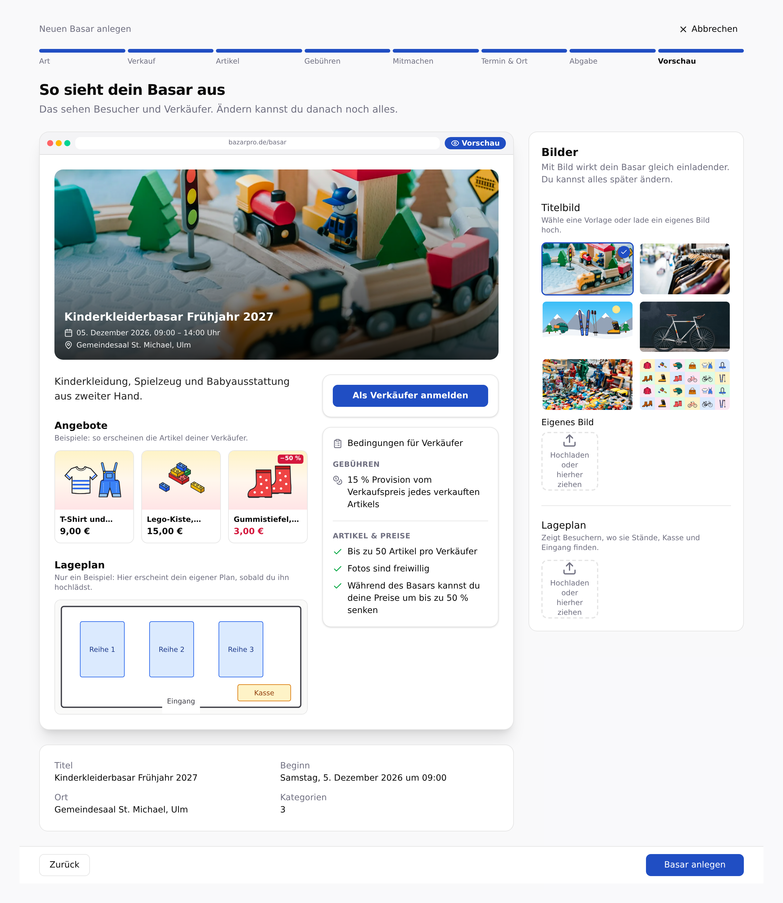

import { Aside, LinkCard, Steps } from '@astrojs/starlight/components';

In dieser Anleitung legst du einen Basar an. Ein Assistent führt dich in acht Schritten durch alle Einstellungen und erklärt bei jedem Schritt, was sie für deine Verkäufer bedeuten. Plane dafür etwa zehn Minuten ein.

**Du brauchst:** ein BazarPro-Konto. Noch keins? [Kostenlos als Veranstalter registrieren](https://bazarpro.de/register?role=organizer). Ein Titelbild und ein Lageplan sind optional, machen deinen Basar aber deutlich ansprechender.

## Basar anlegen

<Steps>

1. **Zum Bereich „Organisieren“ wechseln.** Oben in der Seitenleiste auf **Organisieren** klicken.

2. **„Neuer Basar“ öffnen.** Unter **Alle Basare** auf **Neuer Basar** klicken.

   

3. **Art des Basars wählen.** Die Art setzt passende Einstellungen vor. Du kannst in den folgenden Schritten alles ändern.

   

   | Art | Voreinstellungen |
   | --- | --- |
   | **Kinderbasar** | Kleine [Universal-Etiketten](/veranstalter/universal-etiketten/), Fotos freiwillig, 50 Artikel pro Verkäufer, Rabatte, 15 % Provision |
   | **Kleider- & Second-Hand-Basar** | Kleine [Universal-Etiketten](/veranstalter/universal-etiketten/), Fotos freiwillig, 30 Artikel pro Verkäufer, Rabatte, Preisvorschläge und Fragen, 10 % Provision |
   | **Skibasar** | Große Etiketten mit Preis, Fotos freiwillig, 15 Artikel pro Verkäufer, Verhandlungsbasis, Preisvorschläge und Fragen, 10 % Provision |
   | **Fahrradbörse** | Große Etiketten mit Preis, Fotos Pflicht, Verhandlungsbasis, Preisvorschläge und Fragen, 10 % Provision |

   Die Arten wählen auch passende Kategorien vor, bei Fahrradbörsen zum Beispiel alle Rad-Kategorien. Hast du schon einmal einen Basar angelegt, kannst du stattdessen dessen Einstellungen übernehmen. Mit **Ohne Vorlage weiter** startest du ohne Voreinstellungen.

4. **Wie wird verkauft?** Hier schaltest du die Funktionen ein, die zu deinem Basar passen. Die Vorschau rechts zeigt, was das für Käufer bedeutet.

   

   | Funktion | Was sie bringt |
   | --- | --- |
   | **Artikel rabattieren** | Verkäufer senken während des Basars ihren Preis, höchstens bis zu deinem Höchstrabatt. Ab wann das gilt, legst du bei „Wann und wo?“ fest. |
   | **Preisvorschläge online** | Angemeldete Käufer schlagen während des Basars einen Preis vor. Nimmt der Verkäufer an, gilt der Preis an der Kasse. |
   | **Verhandeln vor Ort (Mindestpreis / VB)** | Verkäufer hinterlegen einen Mindestpreis, den Käufer nicht sehen. An der Kasse darf bis dahin heruntergehandelt werden. |
   | **Fragen an den Verkäufer** | Käufer fragen öffentlich am Artikel nach, alle sehen die Antwort. Mit **Erst während des Basars** sind Fragen erst ab Basarbeginn möglich. |

5. **Welche Artikel?**

   

   - **Kategorien** – Verkäufer können nur Artikel aus diesen Kategorien anbieten. Manche Kategorien bringen **Zusatzfelder** mit, z. B. Rahmennummer und Rahmengröße bei Rädern oder Größe und Marke bei Kleidung.
   - **Artikel ohne Foto erlauben** – sinnvoll bei vielen kleinen Teilen wie auf einem Kinderbasar.
   - **Pflichtangaben** – Zusatzfelder, die jeder Artikel haben muss, bevor er angemeldet werden kann, z. B. die Rahmennummer.
   - **Artikel pro Verkäufer** (optional) – damit Annahme und Platz reichen.
   - **Etiketten** – **Groß** (12 pro A4-Seite, z. B. für Fahrräder) oder **Klein** (40 pro A4-Seite, z. B. für Kleidung). Auf jedem Etikett stehen QR-Code, Titel und die Größe. Unter **Verkäufer auf dem Etikett** wählst du dazu das [Universal-Etikett](/veranstalter/universal-etiketten/) mit Sortierzeichen (Standard) oder nur den QR-Code. **Preis aufs Etikett drucken** hilft an der Kasse, geht aber nur ohne Rabatte, weil ein gedruckter Preis nicht sinken kann.

6. **Was kostet es die Verkäufer?**

   

   - **Provisionsgebühr** – der Anteil am Verkaufspreis, den du einbehältst.
   - **Annahmegebühr pro Artikel** (optional) – fällt für jeden angenommenen Artikel an, auch wenn er nicht verkauft wird, zum Beispiel 3 € pro Rad. Sie wird bei der Abrechnung von der Auszahlung abgezogen.

   <Aside type="tip" title="Beispiel">
     Bei 15 % Provision und einem Fahrrad für 40,00 € bekommt der Verkäufer 34,00 €, 6,00 € bleiben bei dir. Mit 3,00 € Annahmegebühr bekommt er 31,00 €. Verkäufer sehen diese Rechnung vor der Anmeldung als Beispiel.
   </Aside>

7. **Wer darf mitmachen?**

   

   Mit der **Angebotssichtbarkeit** bestimmst du, wer deinen Basar und seine Artikel sehen kann:

   | Einstellung | Wer sieht was? |
   | --- | --- |
   | **Öffentlich** | Alle, auch ohne Konto. Dein Basar erscheint nach einer kurzen Prüfung auf der Startseite. |
   | **Nur eingeloggte Nutzer** | Basar und Angebote sind nur nach dem Login sichtbar. |
   | **Nur mit Link und Zugangscode** | Der Basar erscheint nicht in der Suche, auf der Startseite oder bei Suchmaschinen. Wer den Link hat, sieht die Basarseite. Anmelden kann sich nur, wer ein Konto hat und den Code eingibt, dafür ist der Code Pflicht. Die Angebote sehen nur angemeldete Verkäufer, dein Team und Administratoren. |

   Mit einem **Zugangscode** können sich nur Verkäufer anmelden, denen du den Code gibst. Das **Teilnehmerlimit** begrenzt die Zahl der Verkäufer. Einzelne Personen lädst du später auch [per E-Mail ein](/veranstalter/basartag/#verkäufer-und-helfer-einladen), sie brauchen dann keinen Code.

   Für einen Nachweis gegenüber der Polizei gibt es zwei weitere Schalter:

   - **Nur Privatverkäufer** – Verkäufer bestätigen bei der Anmeldung, dass sie nicht gewerblich verkaufen.
   - **Feste Daten für den Nachweis** – ab dem ersten angenommenen Artikel sind Name und Anschrift des Verkäufers sowie Titel, Kategorie, Preis und Pflichtangaben jedes angenommenen Artikels fest.

8. **Wann und wo?** Diese Angaben erscheinen auf der Basar-Seite und in den Mails an Verkäufer.

   

   - **Titel** – mindestens 3 Zeichen, z. B. „Kinderkleiderbasar Frühjahr 2027“.
   - **Beschreibung** – mindestens 10 Zeichen. Du kannst Überschriften, Listen, **fett**, *kursiv* und Links verwenden. Mit **Vorschau** siehst du, wie es aussieht.
   - **Veranstaltungsort und Adresse** – der Ort so genau wie möglich, z. B. mit Halle oder Eingang. Mit Adresse finden Besucher den Weg, und Google zeigt deinen Basar in der Veranstaltungssuche.
   - **Start- und Enddatum** – der Basar muss frühestens morgen beginnen.
   - **Rabatte erst ab** (optional) – erscheint, wenn du Rabatte eingeschaltet hast.
   - **Kontaktdaten** – sehen Verkäufer und Besucher auf der Seite deines Basars.
   - **Standortkategorien** (optional) – zum Beispiel „Halle B“ oder „Tisch 1–10“. Bei der Warenannahme ordnest du jedem Artikel einen Standort zu, Besucher sehen dann beim Scannen, wo er liegt.

9. **Abgabe und Abholung.** Trage ein, wann Verkäufer ihre Artikel bringen und wann sie Unverkauftes und ihr Geld abholen, dazu einen Hinweis wie „Eingang über den Hof“. Die Zeiten stehen in den Bedingungen und in den automatischen Mails (siehe unten). Mit **Vorschau der Mail am Vorabend** siehst du genau, was verschickt wird.

   

10. **So sieht dein Basar aus.** Zum Schluss siehst du die Vorschau mit den wichtigsten Angaben und den Bedingungen für Verkäufer. Rechts wählst du ein **Titelbild** und lädst optional einen **Lageplan** hoch. Mit **Basar anlegen** legst du den Basar an. Er erscheint unter **Alle Basare**.

    

</Steps>

Ein Schritt geht erst weiter, wenn seine Angaben stimmen. Mit **Zurück** kannst du jederzeit einen Schritt zurückgehen.

## Automatische Mails an Verkäufer

Ohne dass du etwas tun musst, schickt BazarPro deinen Verkäufern zwei Mails:

- **Am Vorabend um 18 Uhr** an alle mit angemeldeten Artikeln: Basarzeit, Ort, Abgabezeit, Verkäufernummer, Anzahl der Artikel, ein Hinweis auf Etiketten und digitalen Ausweis, dein Hinweistext und deine Kontaktdaten.
- **Zur Abholung** an alle, die etwas abgegeben haben und noch nicht abgerechnet sind: was verkauft wurde, der Auszahlungsbetrag und die abzuholenden Artikel. Die Mail kommt direkt nach Basarende oder 2 Stunden vor einer späteren Abholzeit.

Verschiebst du den Basar, gehen die Mails zum neuen Termin noch einmal raus.

## Einstellungen später ändern

Unter **Einstellungen** findest du alle Angaben auf einer Seite, in denselben Abschnitten wie im Assistenten. Ein paar Dinge sind fest, sobald sich Verkäufer darauf verlassen:

- **Provision und Annahmegebühr** kannst du nach der ersten Anmeldung nur noch senken.
- **Artikel pro Verkäufer** kannst du nach der ersten Anmeldung nur noch erhöhen.
- **Während des Basars** sind Datum, Provision und Sichtbarkeit gesperrt, damit Abrechnung und Freigabe stimmen.

## Freigabe öffentlicher Basare

Damit auf der öffentlichen Startseite nur echte Basare erscheinen, prüft ein Administrator jeden **öffentlichen** Basar, bevor er sichtbar wird. Bis dahin ist er nur für dich sichtbar. Basare mit den Einstellungen **Nur eingeloggte Nutzer** oder **Nur mit Link und Zugangscode** sind sofort aktiv.

Änderst du die Sichtbarkeit eines bestehenden Basars später auf **Öffentlich**, wird er erneut geprüft.

<Aside type="caution">
  Fehlt der Button **Neuer Basar**, ist das Anlegen von Basaren auf dieser BazarPro-Instanz gerade deaktiviert. Wende dich an den Betreiber.
</Aside>

## Wie geht es weiter?

Teile den Link zu deinem Basar mit deinen Verkäufern – und, falls du einen nutzt, den Zugangscode. Einzelne Personen kannst du auch [per E-Mail einladen](/veranstalter/basartag/#verkäufer-und-helfer-einladen). Wie sich Verkäufer anmelden und ihre Artikel inserieren, steht in [Einen Artikel inserieren](/verkaeufer/artikel-inserieren/). Wie Annahme, Kasse und Abrechnung laufen, steht in [Der Basartag](/veranstalter/basartag/).

<LinkCard
  title="Jetzt kostenlos Basar anlegen"
  description="Konto bei bazarpro.de erstellen und in zehn Minuten deinen Basar einrichten – ohne Provision für BazarPro, ohne Abo."
  href="https://bazarpro.de/register?role=organizer"
/>
