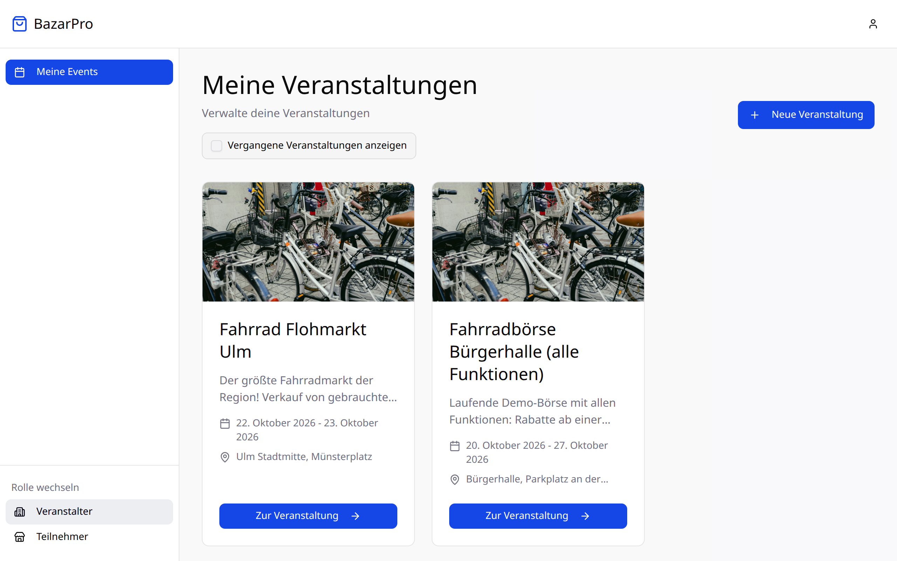
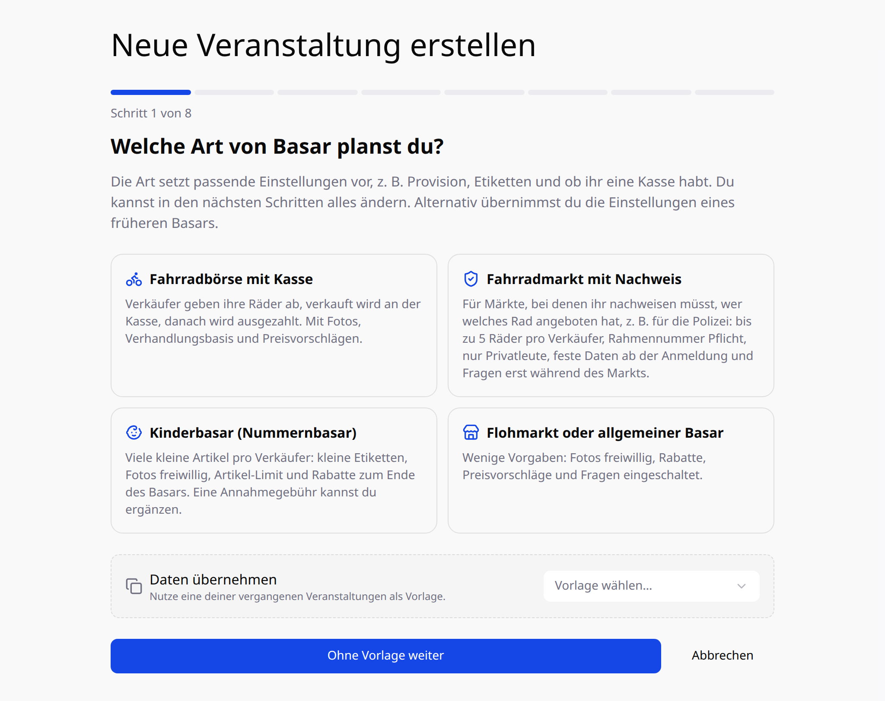
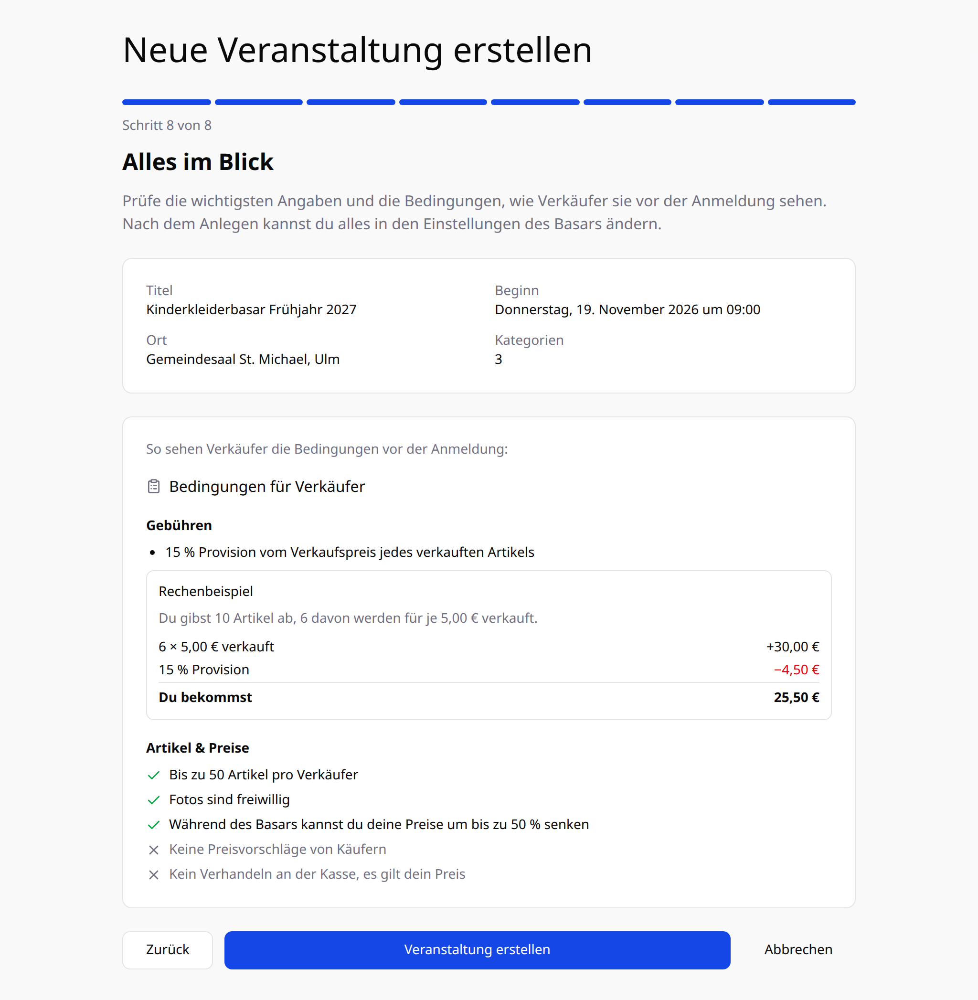

import { Aside, LinkCard, Steps } from '@astrojs/starlight/components';

In dieser Anleitung legst du einen Basar an. Ein Assistent führt dich in acht Schritten durch alle Einstellungen und erklärt bei jedem Schritt, was sie für deine Verkäufer bedeuten. Plane dafür etwa zehn Minuten ein.

**Du brauchst:** ein BazarPro-Konto. Noch keins? [Kostenlos als Veranstalter registrieren](https://bazarpro.de/register?role=organizer). Ein Titelbild und ein Lageplan sind optional, machen deinen Basar aber deutlich ansprechender.

## Basar anlegen

<Steps>

1. **Zur Rolle „Veranstalter“ wechseln.** Unten in der Seitenleiste unter **Rolle wechseln** auf **Veranstalter** klicken.

2. **„Neue Veranstaltung“ öffnen.** Unter **Meine Events** auf **Neue Veranstaltung** klicken.

   

3. **Art des Basars wählen.** Die Art setzt passende Einstellungen vor. Du kannst in den folgenden Schritten alles ändern.

   

   | Art | Voreinstellungen |
   | --- | --- |
   | **Fahrradbörse mit Kasse** | Fotos, Verhandlungsbasis, Preisvorschläge, große Etiketten mit Preis, 10 % Provision |
   | **Fahrradmarkt mit Nachweis** | Für Märkte, bei denen ihr z. B. der Polizei nachweisen müsst, wer welches Rad angeboten hat: höchstens 5 Räder pro Verkäufer, Rahmennummer Pflicht, nur Privatverkäufer, feste Daten, Fragen erst während des Markts, 20 % Provision |
   | **Kinderbasar (Nummernbasar)** | Kleine Etiketten, Fotos freiwillig, 50 Artikel pro Verkäufer, Rabatte, 15 % Provision |
   | **Flohmarkt oder allgemeiner Basar** | Wenige Vorgaben: Fotos freiwillig, Rabatte, Preisvorschläge und Fragen, 10 % Provision |

   Die Arten wählen auch passende Kategorien vor, bei Fahrradbörsen zum Beispiel alle Rad-Kategorien. Hast du schon einmal einen Basar angelegt, kannst du stattdessen dessen Einstellungen übernehmen. Mit **Ohne Vorlage weiter** startest du ohne Voreinstellungen.

4. **Wann und wo?** Titel, Beschreibung, Datum und Ort erscheinen auf der Basar-Seite und in den Mails an Verkäufer.

   - **Titel** – mindestens 3 Zeichen, z. B. „Kinderkleiderbasar Frühjahr 2027“.
   - **Beschreibung** – mindestens 10 Zeichen. Du kannst Überschriften, Listen, **fett**, *kursiv* und Links verwenden. Mit **Vorschau** siehst du, wie es aussieht.
   - **Ort** – so genau wie möglich, z. B. mit Halle oder Eingang.
   - **Start- und Enddatum** – der Basar muss frühestens morgen beginnen.
   - **Titelbild und Lageplan** (optional) – Zum Lageplan legst du **Standortkategorien** wie „Halle B“ oder „Tisch 1–10“ an. Bei der Warenannahme ordnest du jedem Artikel einen Standort zu, Besucher sehen dann beim Scannen, wo er liegt.

5. **Wie wird verkauft?** Hier schaltest du die Funktionen ein, die zu deinem Basar passen:

   | Funktion | Was sie bringt |
   | --- | --- |
   | **Artikel rabattieren** | Verkäufer senken während des Basars ihren Preis, ab einer Uhrzeit, die du festlegst, und höchstens bis zu deinem Höchstrabatt. |
   | **Preisvorschläge online** | Angemeldete Käufer schlagen während des Basars einen Preis vor. Nimmt der Verkäufer an, gilt der Preis an der Kasse. |
   | **Verhandeln vor Ort (Mindestpreis / VB)** | Verkäufer hinterlegen einen Mindestpreis, den Käufer nicht sehen. An der Kasse darf bis dahin heruntergehandelt werden. |
   | **Fragen an den Verkäufer** | Käufer fragen öffentlich am Artikel nach, alle sehen die Antwort. Mit **Erst während des Basars** sind Fragen erst ab Basarbeginn möglich. |

6. **Was kostet es die Verkäufer?**

   - **Provisionsgebühr** – der Anteil am Verkaufspreis, den du einbehältst.
   - **Annahmegebühr pro Artikel** (optional) – fällt für jeden angenommenen Artikel an, auch wenn er nicht verkauft wird, zum Beispiel 3 € pro Rad. Sie wird bei der Abrechnung von der Auszahlung abgezogen.
   - **Kontaktdaten** – sehen Verkäufer und Besucher auf der Seite deines Basars.

   <Aside type="tip" title="Beispiel">
     Bei 15 % Provision und einem Fahrrad für 40,00 € bekommt der Verkäufer 34,00 €, 6,00 € bleiben bei dir. Mit 3,00 € Annahmegebühr bekommt er 31,00 €. Verkäufer sehen diese Rechnung vor der Anmeldung als Beispiel.
   </Aside>

7. **Welche Artikel?**

   - **Kategorien** – Verkäufer können nur Artikel aus diesen Kategorien anbieten. Manche Kategorien bringen **Zusatzfelder** mit, z. B. Rahmennummer und Rahmengröße bei Rädern oder Größe und Marke bei Kleidung.
   - **Pflichtangaben** – Zusatzfelder, die jeder Artikel haben muss, bevor er angemeldet werden kann, z. B. die Rahmennummer.
   - **Artikel ohne Foto erlauben** – sinnvoll bei vielen kleinen Teilen wie auf einem Kinderbasar.
   - **Artikel pro Verkäufer** (optional) – damit Annahme und Platz reichen.
   - **Etiketten** – **Groß** (12 pro A4-Seite, z. B. für Fahrräder) oder **Klein** (40 pro A4-Seite, z. B. für Kleidung). Auf jedem Etikett stehen QR-Code, Verkäufernummer, Titel und die Größe. **Preis aufs Etikett drucken** hilft an der Kasse, geht aber nur ohne Rabatte, weil ein gedruckter Preis nicht sinken kann.

8. **Wer darf mitmachen?**

   Mit der **Angebotssichtbarkeit** bestimmst du, wer die Artikel deines Basars sehen kann:

   | Einstellung | Wer sieht die Angebote? |
   | --- | --- |
   | **Öffentlich** | Alle, auch ohne Konto. Dein Basar erscheint nach einer kurzen Prüfung auf der Startseite. |
   | **Nur eingeloggte Nutzer** | Nur Besucher mit BazarPro-Konto. |
   | **Nur freigeschaltete Benutzer** | Nur Nutzer, die ausdrücklich freigeschaltet wurden. |

   Mit einem **Zugangscode** können sich nur Verkäufer anmelden, denen du den Code gibst. Das **Teilnehmerlimit** begrenzt die Zahl der Verkäufer.

   Für einen Nachweis gegenüber der Polizei gibt es zwei weitere Schalter:

   - **Nur Privatverkäufer** – Verkäufer bestätigen bei der Anmeldung, dass sie nicht gewerblich verkaufen.
   - **Feste Daten für den Nachweis** – ab dem ersten angemeldeten Artikel sind Name und Anschrift des Verkäufers sowie Titel, Kategorie, Preis und Pflichtangaben des Artikels fest. Abmelden geht nur bis Basarbeginn.

9. **Abgabe und Abholung.** Trage ein, wann Verkäufer ihre Artikel bringen und wann sie Unverkauftes und ihr Geld abholen, dazu einen Hinweis wie „Eingang über den Hof“. Die Zeiten stehen in den Bedingungen und in den automatischen Mails (siehe unten). Mit **Vorschau der Mail am Vorabend** siehst du genau, was verschickt wird.

10. **Alles im Blick.** Zum Schluss siehst du die wichtigsten Angaben und die Bedingungen genau so, wie Verkäufer sie vor der Anmeldung sehen, mit Rechenbeispiel. Mit **Veranstaltung erstellen** legst du den Basar an. Er erscheint unter **Meine Events**.

    

</Steps>

Ein Schritt geht erst weiter, wenn seine Angaben stimmen. Mit **Zurück** kannst du jederzeit einen Schritt zurückgehen.

## Automatische Mails an Verkäufer

Ohne dass du etwas tun musst, schickt BazarPro deinen Verkäufern zwei Mails:

- **Am Vorabend um 18 Uhr** an alle mit angemeldeten Artikeln: Basarzeit, Ort, Abgabezeit, Verkäufernummer, Anzahl der Artikel, ein Hinweis auf Etiketten und digitalen Ausweis, dein Hinweistext und deine Kontaktdaten.
- **Zur Abholung** an alle, die etwas abgegeben haben und noch nicht abgerechnet sind: was verkauft wurde, der Auszahlungsbetrag und die abzuholenden Artikel. Die Mail kommt direkt nach Basarende oder 2 Stunden vor einer späteren Abholzeit.

Verschiebst du den Basar, gehen die Mails zum neuen Termin noch einmal raus.

## Einstellungen später ändern

Unter **Einstellungen bearbeiten** findest du alle Angaben in einem Formular. Ein paar Dinge sind fest, sobald sich Verkäufer darauf verlassen:

- **Provision und Annahmegebühr** kannst du nach der ersten Anmeldung nur noch senken.
- **Artikel pro Verkäufer** kannst du nach der ersten Anmeldung nur noch erhöhen.
- **Während des Basars** sind Datum, Provision und Sichtbarkeit gesperrt, damit Abrechnung und Freigabe stimmen.

## Freigabe öffentlicher Basare

Damit auf der öffentlichen Startseite nur echte Basare erscheinen, prüft ein Administrator jeden **öffentlichen** Basar, bevor er sichtbar wird. Bis dahin ist er nur für dich sichtbar. Basare mit den Einstellungen **Nur eingeloggte Nutzer** oder **Nur freigeschaltete Benutzer** sind sofort aktiv.

Änderst du die Sichtbarkeit eines bestehenden Basars später auf **Öffentlich**, wird er erneut geprüft.

<Aside type="caution">
  Fehlt der Button **Neue Veranstaltung**, ist das Anlegen von Basaren auf dieser BazarPro-Instanz gerade deaktiviert. Wende dich an den Betreiber.
</Aside>

## Wie geht es weiter?

Teile den Link zu deinem Basar mit deinen Verkäufern – und, falls du einen nutzt, den Zugangscode. Wie sich Verkäufer anmelden und ihre Artikel inserieren, steht in [Einen Artikel inserieren](/verkaeufer/artikel-inserieren/). Wie Annahme, Kasse und Abrechnung laufen, steht in [Der Basartag](/veranstalter/basartag/).

<LinkCard
  title="Jetzt kostenlos Basar anlegen"
  description="Konto bei bazarpro.de erstellen und in zehn Minuten deinen Basar einrichten – ohne Provision für BazarPro, ohne Abo."
  href="https://bazarpro.de/register?role=organizer"
/>
