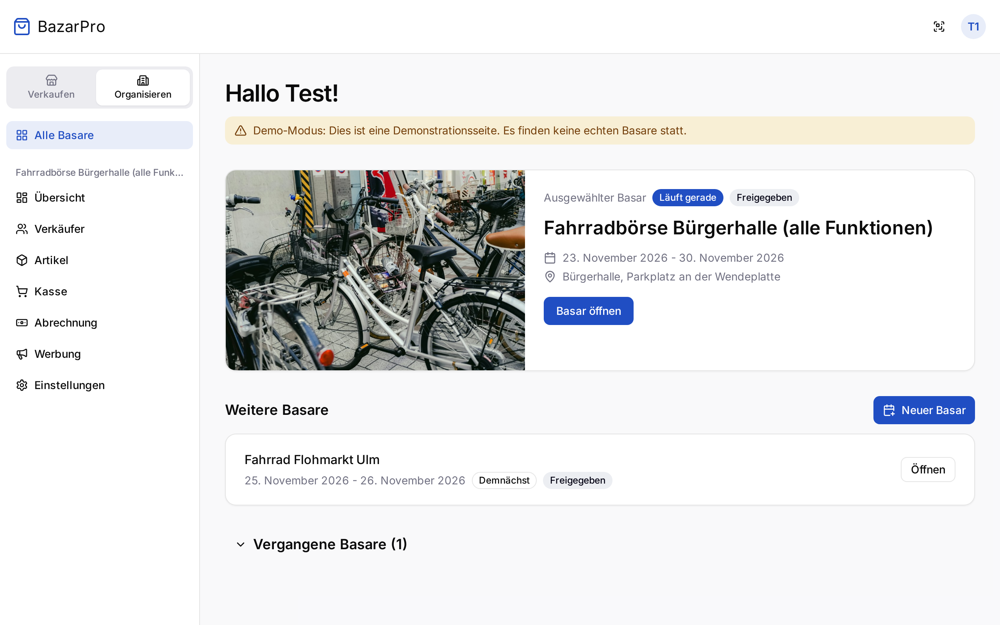
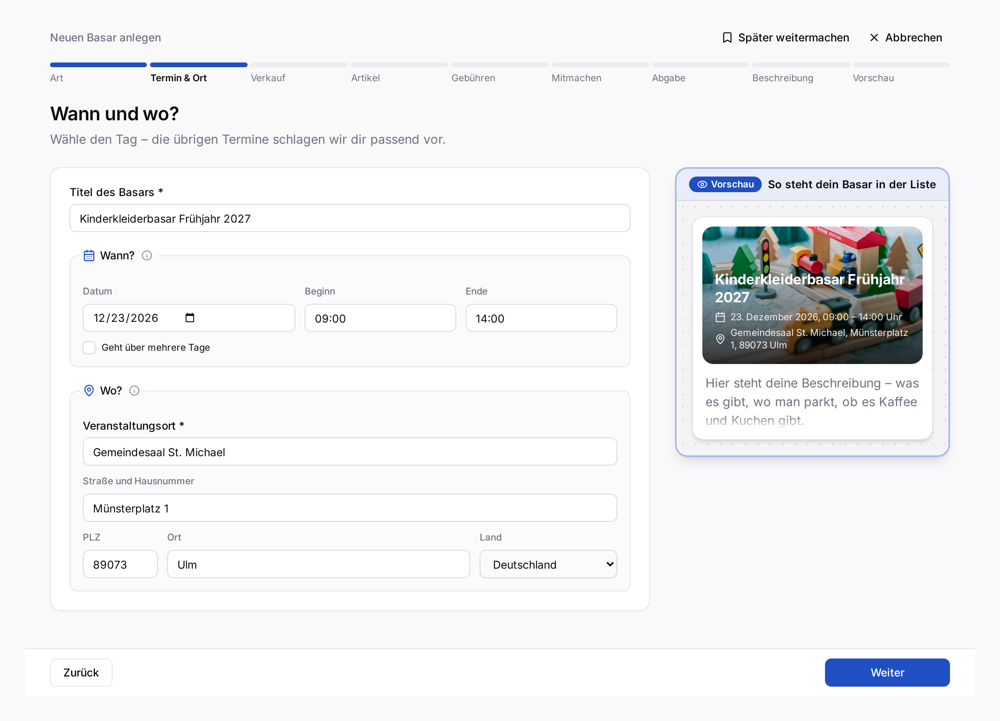
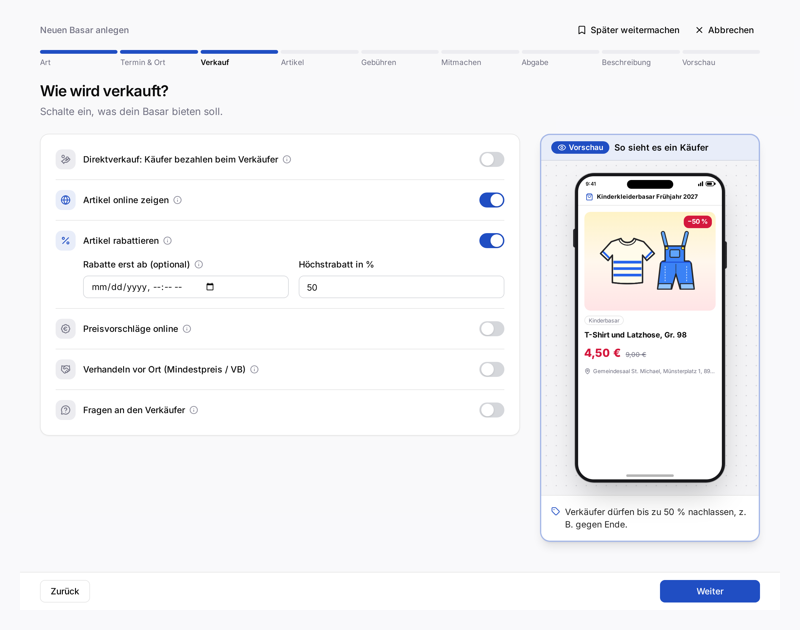
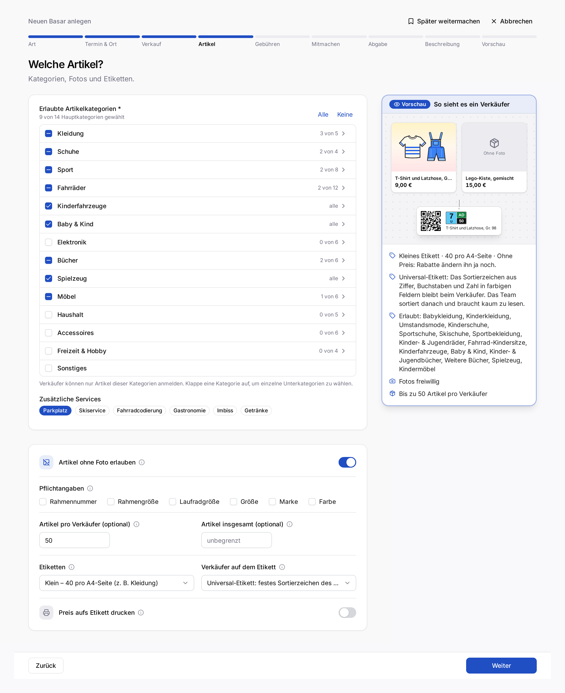
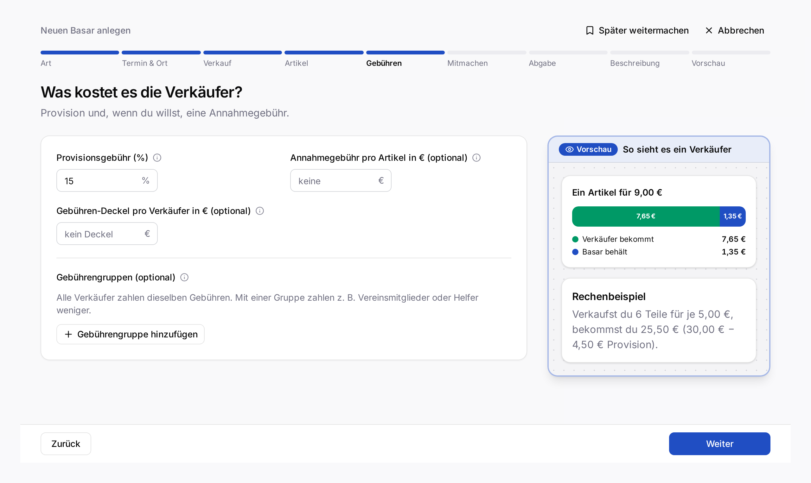
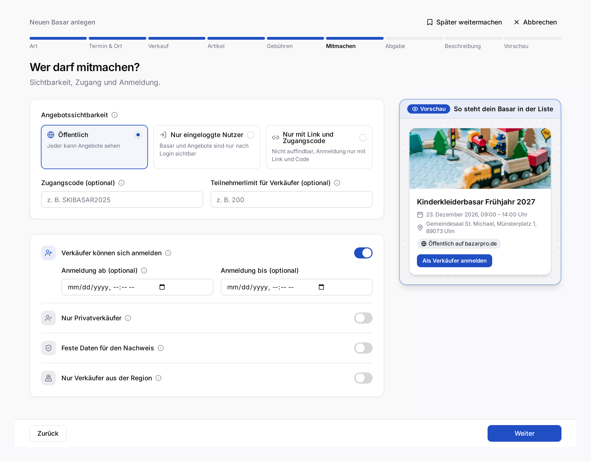
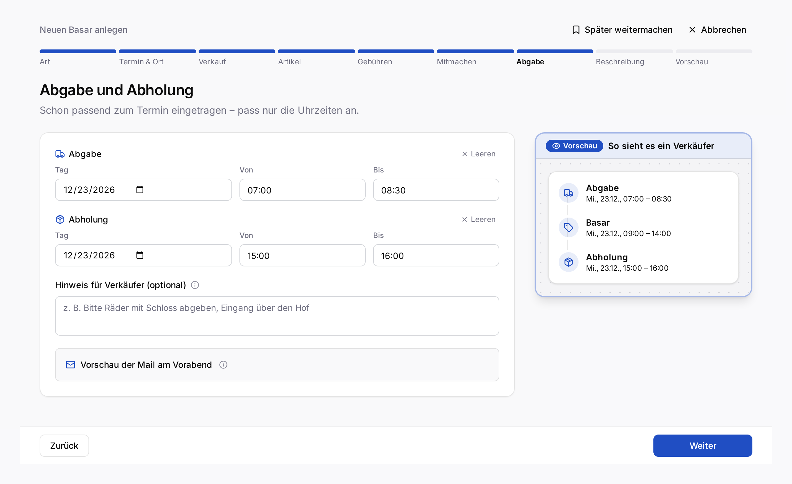
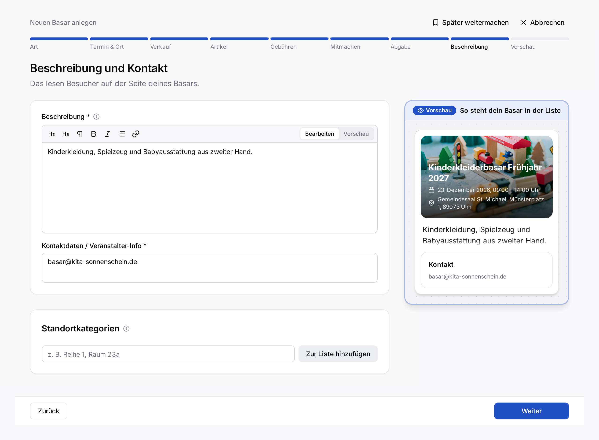
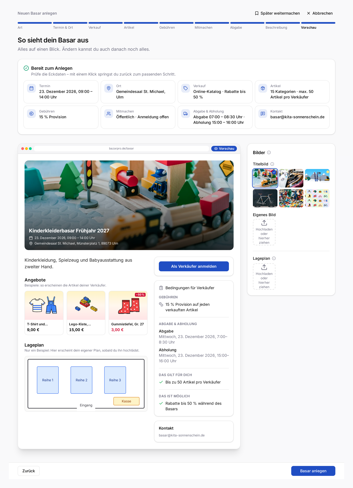

import { Aside, LinkCard, Steps } from '@astrojs/starlight/components';

In dieser Anleitung legst du einen Basar an. Ein Assistent führt dich in neun Schritten durch alle Einstellungen und erklärt bei jedem Schritt, was sie für deine Verkäufer bedeuten. Plane dafür etwa zehn Minuten ein.

**Du brauchst:** ein BazarPro-Konto. Noch keins? [Kostenlos als Veranstalter registrieren](https://bazarpro.de/register?role=organizer). Ein Titelbild und ein Lageplan sind optional, machen deinen Basar aber deutlich ansprechender.

## Basar anlegen

<Steps>

1. **Zum Bereich „Organisieren“ wechseln.** Oben in der Seitenleiste auf **Organisieren** klicken.

2. **„Neuer Basar“ öffnen.** Unter **Alle Basare** auf **Neuer Basar** klicken.

   

3. **Art des Basars wählen.** Die Art setzt passende Einstellungen vor. Du kannst in den folgenden Schritten alles ändern.

   

   | Art | Voreinstellungen |
   | --- | --- |
   | **Kinderbasar** | Kleine [Universal-Etiketten](/veranstalter/universal-etiketten/), Fotos freiwillig, 50 Artikel pro Verkäufer, Rabatte, 15 % Provision |
   | **Kleider- & Second-Hand-Basar** | Kleine [Universal-Etiketten](/veranstalter/universal-etiketten/), Fotos freiwillig, 30 Artikel pro Verkäufer, Rabatte, Preisvorschläge und Fragen, 10 % Provision |
   | **Skibasar** | Große Etiketten mit Preis, Fotos freiwillig, 15 Artikel pro Verkäufer, Verhandlungsbasis, Preisvorschläge und Fragen, 10 % Provision |
   | **Fahrradbörse** | Große Etiketten mit Preis, Fotos Pflicht, Rahmennummer Pflicht, Verhandlungsbasis, Preisvorschläge und Fragen, 10 % Provision, 3 € Annahmegebühr pro Rad |

   Die Arten wählen auch passende Kategorien vor, bei Fahrradbörsen zum Beispiel alle Kategorien für Räder und Kinderfahrzeuge wie Laufräder und Roller. Hast du schon einmal einen Basar angelegt, kannst du stattdessen dessen Einstellungen übernehmen. Mit **Ohne Vorlage weiter** startest du ohne Voreinstellungen.

4. **Wann und wo?** Wähle zuerst den Tag. Die übrigen Termine, etwa für Rabatte, Anmeldung, Abgabe und Abholung, schlägt der Assistent danach passend vor.

   

   - **Titel** – mindestens 3 Zeichen, z. B. „Kinderkleiderbasar Frühjahr 2027“.
   - **Veranstaltungsort und Adresse** – der Ort so genau wie möglich, z. B. mit Halle oder Eingang. Mit Adresse finden Besucher den Weg, und Google zeigt deinen Basar in der Veranstaltungssuche. Die Postleitzahl braucht auch die [Region](#nur-verkäufer-aus-der-region) als Mittelpunkt.
   - **Datum, Beginn und Ende** – der Basar muss frühestens morgen beginnen. Uhrzeiten gibst du im 24-Stunden-Format ein. Dauert er länger als einen Tag, setze den Haken bei **Geht über mehrere Tage** und wähle den ersten und den letzten Tag.

   Rechts siehst du, wie dein Basar in der Liste der Basare erscheint.

5. **Wie wird verkauft?** Hier schaltest du die Funktionen ein, die zu deinem Basar passen. Die Vorschau rechts zeigt, was das für Käufer bedeutet.

   

   | Funktion | Was sie bringt |
   | --- | --- |
   | **Artikel online zeigen** | Besucher sehen die Artikel schon vor dem Basar online, mit Preis und Fotos. Ausgeschaltet gibt es keine Online-Liste, vor Ort zeigt das QR-Etikett trotzdem den Preis. Preisvorschläge und Fragen gibt es nur mit Online-Liste. |
   | **Artikel rabattieren** | Verkäufer senken während des Basars ihren Preis, höchstens bis zu deinem Höchstrabatt. Mit **Rabatte erst ab** legst du fest, ab wann das gilt. |
   | **Preisvorschläge online** | Angemeldete Käufer schlagen während des Basars einen Preis vor. Nimmt der Verkäufer an, gilt der Preis an der Kasse. |
   | **Verhandeln vor Ort (Mindestpreis / VB)** | Verkäufer hinterlegen einen Mindestpreis, den Käufer nicht sehen. An der Kasse darf bis dahin heruntergehandelt werden. |
   | **Fragen an den Verkäufer** | Käufer fragen öffentlich am Artikel nach, alle sehen die Antwort. Mit **Erst während des Basars** sind Fragen erst ab Basarbeginn möglich. |
   | **Direktverkauf** | Verkäufer stehen selbst an ihren Artikeln, siehe [Direktverkauf](#direktverkauf). |

6. **Welche Artikel?**

   

   - **Kategorien** – Verkäufer können nur Artikel aus diesen Kategorien anmelden. Jede Hauptkategorie hat Unterkategorien, zum Beispiel **Fahrräder** mit Kinderfahrrädern, E-Bikes und Lastenrädern. Klappe eine Hauptkategorie auf, um nur einzelne Unterkategorien zu erlauben. Manche Kategorien bringen **Zusatzfelder** mit, z. B. Rahmennummer, Rahmengröße und Farbe bei Rädern oder Größe und Marke bei Kleidung.
   - **Zusätzliche Services** – was es bei deinem Basar außerdem gibt, zum Beispiel Parkplätze, Getränke, einen Skiservice oder eine **Fahrradcodierung**. Die Services stehen auf der Seite deines Basars.
   - **Artikel ohne Foto erlauben** – sinnvoll bei vielen kleinen Teilen wie auf einem Kinderbasar.
   - **Pflichtangaben** – Zusatzfelder, die jeder Artikel haben muss, bevor er angemeldet werden kann, z. B. die Rahmennummer. Findet ein Verkäufer die Rahmennummer nicht, trägt er mit **Nicht gefunden** einheitlich „nicht gefunden“ ein. Ihr sucht sie dann bei der Abgabe gemeinsam.
   - **Artikel pro Verkäufer** (optional) – damit Annahme und Platz reichen.
   - **Artikel insgesamt** (optional) – begrenzt die Artikel aller Verkäufer zusammen, zum Beispiel auf das, was in die Halle passt. Verkäufer sehen bei der Anmeldung, wie viele Plätze für Artikel noch frei sind. Ist alles belegt, kann niemand mehr Artikel anmelden.
   - **Etiketten** – **Groß** (12 pro A4-Seite, z. B. für Fahrräder) oder **Klein** (40 pro A4-Seite, z. B. für Kleidung). Auf jedem Etikett stehen QR-Code, Titel und die Größe. Unter **Verkäufer auf dem Etikett** wählst du dazu das [Universal-Etikett](/veranstalter/universal-etiketten/) mit Sortierzeichen (Standard) oder nur den QR-Code. **Preis aufs Etikett drucken** hilft an der Kasse, geht aber nur ohne Rabatte, weil ein gedruckter Preis nicht sinken kann.

7. **Was kostet es die Verkäufer?**

   

   - **Provisionsgebühr** – der Anteil am Verkaufspreis, den du einbehältst.
   - **Annahmegebühr pro Artikel** (optional) – fällt für jeden angenommenen Artikel an, auch wenn er nicht verkauft wird, zum Beispiel 3 € pro Rad. Sie wird bei der Abrechnung von der Auszahlung abgezogen.
   - **Gebühren-Deckel pro Verkäufer** (optional) – ein Verkäufer zahlt insgesamt höchstens so viel Provision und Annahmegebühr, zum Beispiel 20 € bei teuren Rädern. Was darüber liegt, bekommt er bei der Abrechnung zurück.
   - **Gebührengruppen** (optional) – eigene Gebühren für eine Gruppe von Verkäufern, zum Beispiel Vereinsmitglieder mit 5 % statt 10 % oder Helfer ohne Provision. Jede Gruppe hat ihre eigene Provision, Annahmegebühr, ihren Deckel und auf Wunsch mehr **Artikel pro Verkäufer**. Unter **Wer gehört dazu?** wählst du:
     - **Verkäufer geben es bei der Anmeldung an** – der Verkäufer wählt die Gruppe selbst. Bei der Abgabe prüft ihr den Nachweis, den du als Hinweis hinterlegst, zum Beispiel „Mitgliedsausweis zeigen“ (siehe [Annahme](/veranstalter/basartag/#annahme)).
     - **Helfer des Basars** – gilt automatisch für alle mit einer Helferrolle. Unter **Verkäufer** ordnest du über das Prozent-Symbol auch Personen ohne Helferrechte zu, zum Beispiel Kuchenspender.

     Wer zu mehreren Gruppen gehört, zahlt die günstigsten Gebühren. Verkäufer sehen alle Gruppen in den Bedingungen.

   <Aside type="tip" title="Beispiel">
     Bei 15 % Provision und einem Fahrrad für 40,00 € bekommt der Verkäufer 34,00 €, 6,00 € bleiben bei dir. Mit 3,00 € Annahmegebühr bekommt er 31,00 €. Verkäufer sehen vor der Anmeldung ein Rechenbeispiel, das zur Art des Basars passt, zum Beispiel ein Rad für 150 € bei einer Fahrradbörse oder sechs Teile für je 5 € bei einem Kinderbasar. Es enthält nur die Gebühren, die dein Basar wirklich hat.
   </Aside>

8. **Wer darf mitmachen?**

   

   Mit der **Angebotssichtbarkeit** bestimmst du, wer deinen Basar und seine Artikel sehen kann:

   | Einstellung | Wer sieht was? |
   | --- | --- |
   | **Öffentlich** | Alle, auch ohne Konto. Dein Basar erscheint nach einer kurzen Prüfung auf der Startseite. |
   | **Nur eingeloggte Nutzer** | Basar und Angebote sind nur nach dem Login sichtbar. |
   | **Nur mit Link und Zugangscode** | Der Basar erscheint nicht in der Suche, auf der Startseite oder bei Suchmaschinen. Wer den Link hat, sieht die Basarseite. Anmelden kann sich nur, wer ein Konto hat und den Code eingibt, dafür ist der Code Pflicht. Die Angebote sehen nur angemeldete Verkäufer, dein Team und Administratoren. |

   Mit einem **Zugangscode** können sich nur Verkäufer anmelden, denen du den Code gibst. Das **Teilnehmerlimit** begrenzt die Zahl der Verkäufer. Einzelne Personen lädst du später auch [per E-Mail ein](/veranstalter/basartag/#verkäufer-und-helfer-einladen), sie brauchen dann keinen Code.

   - **Verkäufer können sich anmelden** – ausgeschaltet kommt nur noch hinein, wen du einlädst. Mit **Anmeldung ab** und **Anmeldung bis** (beide optional) legst du ein Zeitfenster fest, zum Beispiel ab vier Wochen vor dem Basar bis drei Tage davor. Ohne Angaben ist die Anmeldung sofort und bis zum Ende des Basars offen. Einladungen gelten auch außerhalb dieses Fensters.
   - **Nur Verkäufer aus der Region** – nur Verkäufer mit einer Postleitzahl aus deinen Gebieten melden sich selbst an, siehe [Nur Verkäufer aus der Region](#nur-verkäufer-aus-der-region).

   Für einen Nachweis gegenüber der Polizei gibt es zwei weitere Schalter:

   - **Nur Privatverkäufer** – Verkäufer bestätigen bei der Anmeldung, dass sie nicht gewerblich verkaufen.
   - **Feste Daten für den Nachweis** – ab dem ersten angenommenen Artikel sind Name und Anschrift des Verkäufers sowie Titel, Kategorie, Preis und Pflichtangaben jedes angenommenen Artikels fest.

9. **Abgabe und Abholung.** Trage ein, wann Verkäufer ihre Artikel bringen und wann sie Unverkauftes und ihr Geld abholen, dazu einen Hinweis wie „Eingang über den Hof“. Der Assistent schlägt Zeiten passend zum Termin vor, du passt nur die Uhrzeiten an. Die Zeiten stehen in den Bedingungen und in den automatischen Mails (siehe unten). Mit **Vorschau der Mail am Vorabend** siehst du genau, was verschickt wird. Beim [Direktverkauf](#direktverkauf) heißt der Schritt **Aufbau und Abbau**.

   

10. **Beschreibung und Kontakt.** Das lesen Besucher auf der Seite deines Basars, die Vorschau rechts wächst mit.

    - **Beschreibung** – mindestens 10 Zeichen. Du kannst Überschriften, Listen, **fett**, *kursiv* und Links verwenden. Mit **Vorschau** siehst du, wie es aussieht.
    - **Kontaktdaten** – sehen Verkäufer und Besucher auf der Seite deines Basars.
    - **Standortkategorien** (optional) – zum Beispiel „Halle B“ oder „Tisch 1–10“. Bei der Warenannahme ordnest du jedem Artikel einen Standort zu, Besucher sehen dann beim Scannen, wo er liegt.

    

11. **So sieht dein Basar aus.** Zum Schluss siehst du die Vorschau mit den wichtigsten Angaben, Kontakt und den Bedingungen für Verkäufer. Rechts wählst du ein **Titelbild** und lädst optional einen **Lageplan** hoch. Mit **Basar anlegen** legst du den Basar an. Er erscheint unter **Alle Basare**, mit seinem Zustand **Demnächst**, **Läuft gerade** oder **Beendet**.

    

</Steps>

Ein Schritt geht erst weiter, wenn seine Angaben stimmen. Mit **Zurück** kannst du jederzeit einen Schritt zurückgehen. Mit **Später weitermachen** speicherst du deinen Stand und machst ein anderes Mal weiter.

## Direktverkauf

Bei manchen Märkten stehen die Verkäufer selbst an ihren Artikeln, zum Beispiel bei einer Fahrradbörse mit Ständen. Schalte dafür im Schritt **Wie wird verkauft?** den **Direktverkauf** ein:

- Käufer und Verkäufer einigen sich am Artikel, der Käufer bezahlt direkt beim Verkäufer.
- Danach scannt die Kasse das Etikett, bucht den Verkauf zum vereinbarten Preis und kassiert vom Verkäufer nur die Provision.
- Nach dem Markt gibt es keine Auszahlung. Der Kassensturz zeigt Direktverkäufe getrennt, der Nachweis trotzdem jeden Verkauf.
- Die Zeiten heißen **Aufbau** und **Abbau** statt Abgabe und Abholung, in den Bedingungen, auf der Seite deines Basars und in den Mails. Bei neuen Artikeln ist **Preis verhandelbar** vorausgewählt.

Sobald Verkäufe gebucht sind, lässt sich der Direktverkauf nicht mehr ein- oder ausschalten.

## Nur Verkäufer aus der Region

Soll dein Basar zum Beispiel Familien aus deiner Stadt vorbehalten sein, schalte im Schritt **Wer darf mitmachen?** **Nur Verkäufer aus der Region** ein. Auf einer Karte der Postleitzahlgebiete wählst du den Mittelpunkt (den Ort des Basars oder deinen Standort), ziehst den Umkreis und tippst einzelne Gebiete an oder ab. Postleitzahlen oder ihren Anfang, etwa `7322` oder `AT-6900`, kannst du auch eintippen. Die Region darf über Ländergrenzen gehen.

- Nur wer mit der Postleitzahl aus seinem Profil in der Region liegt, meldet sich selbst an. Alle anderen kommen nur mit einer [Einladung](/veranstalter/basartag/#verkäufer-und-helfer-einladen) hinein, auch wenn der Basar einen Zugangscode hat.
- Verkäufer sehen die Region in den Bedingungen und mit **Karte ansehen** auf der Karte.
- Wer über die Region angemeldet ist, kann Postleitzahl und Land in seinem Profil bis zum Ende des Basars nicht mehr ändern. Kontrolliere sie bei der Abgabe mit dem Ausweis.

## Automatische Mails an Verkäufer

Ohne dass du etwas tun musst, schickt BazarPro deinen Verkäufern zwei Mails:

- **Am Vorabend um 18 Uhr** an alle mit angemeldeten Artikeln: Basarzeit, Ort, Abgabezeit, Verkäufernummer, Anzahl der Artikel, ein Hinweis auf Etiketten und digitalen Ausweis, dein Hinweistext und deine Kontaktdaten.
- **Zur Abholung** an alle, die etwas abgegeben haben und noch nicht abgerechnet sind: was verkauft wurde, der Auszahlungsbetrag und die abzuholenden Artikel. Die Mail kommt direkt nach Basarende oder 2 Stunden vor einer späteren Abholzeit.

Verschiebst du den Basar, gehen die Mails zum neuen Termin noch einmal raus.

## Einstellungen später ändern

Unter **Einstellungen** findest du alle Angaben auf einer Seite, in denselben Abschnitten wie im Assistenten. Ein paar Dinge sind fest, sobald sich Verkäufer darauf verlassen:

- **Provision, Annahmegebühr und Gebühren-Deckel** kannst du nach der ersten Anmeldung nur noch senken. **Gebührengruppen** können dann nur noch günstiger werden, aber nicht mehr wegfallen.
- **Artikel pro Verkäufer** kannst du nach der ersten Anmeldung nur noch erhöhen. Senkst du **Artikel insgesamt**, bleiben schon angemeldete Artikel dabei.
- Die **Anmeldung** öffnest und schließt du jederzeit auch unter **Verkäufer**, siehe [Anmeldung und Teilnahme steuern](/veranstalter/basartag/#anmeldung-und-teilnahme-steuern).
- **Während des Basars** sind Datum, Provision und Sichtbarkeit gesperrt, damit Abrechnung und Freigabe stimmen.

## Freigabe öffentlicher Basare

Damit auf der öffentlichen Startseite nur echte Basare erscheinen, prüft ein Administrator jeden **öffentlichen** Basar, bevor er sichtbar wird. Bis dahin ist er nur für dich sichtbar. Basare mit den Einstellungen **Nur eingeloggte Nutzer** oder **Nur mit Link und Zugangscode** sind sofort aktiv.

Änderst du die Sichtbarkeit eines bestehenden Basars später auf **Öffentlich**, wird er erneut geprüft.

<Aside type="caution">
  Fehlt der Button **Neuer Basar**, ist das Anlegen von Basaren auf dieser BazarPro-Instanz gerade deaktiviert. Wende dich an den Betreiber.
</Aside>

## Wie geht es weiter?

Mach deinen Basar mit Plakaten, Flyern und Bildern für Social Media bekannt, siehe [Werbung](/veranstalter/basartag/#werbung). Teile den Link zu deinem Basar mit deinen Verkäufern – und, falls du einen nutzt, den Zugangscode. Einzelne Personen kannst du auch [per E-Mail einladen](/veranstalter/basartag/#verkäufer-und-helfer-einladen). Wie sich Verkäufer anmelden und ihre Artikel inserieren, steht in [Einen Artikel inserieren](/verkaeufer/artikel-inserieren/). Wie Annahme, Kasse und Abrechnung laufen, steht in [Der Basartag](/veranstalter/basartag/).

<LinkCard
  title="Jetzt kostenlos Basar anlegen"
  description="Konto bei bazarpro.de erstellen und in zehn Minuten deinen Basar einrichten – ohne Provision für BazarPro, ohne Abo."
  href="https://bazarpro.de/register?role=organizer"
/>
