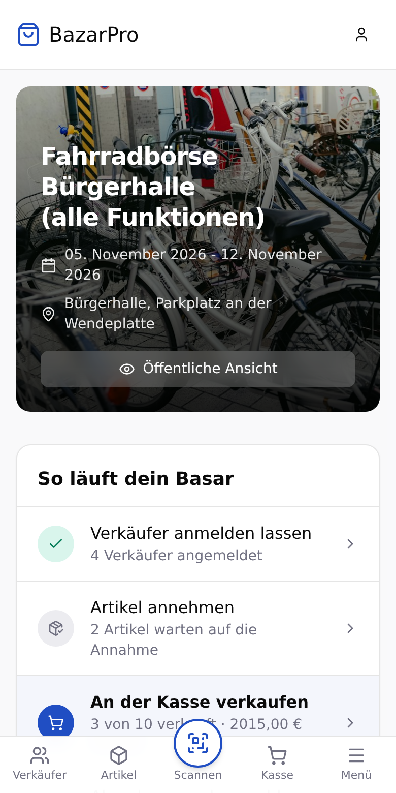
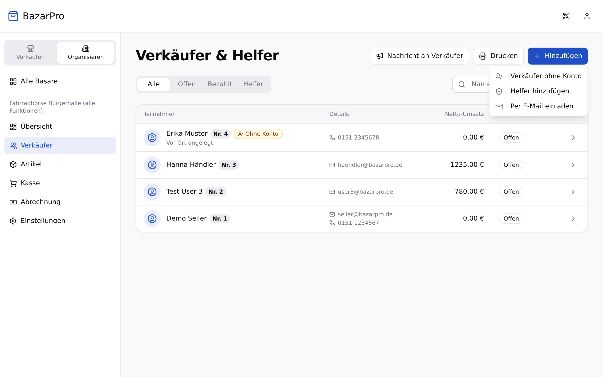
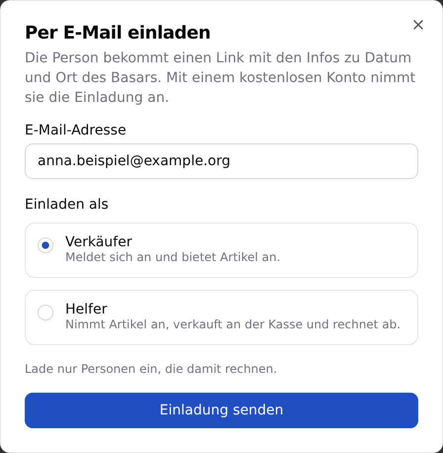
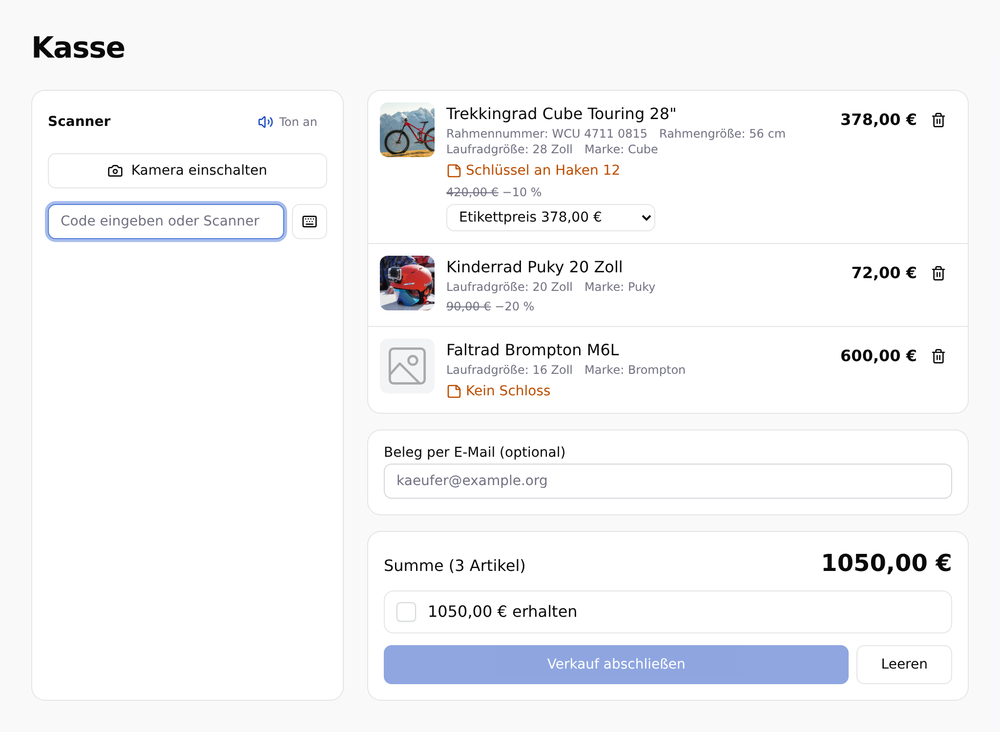
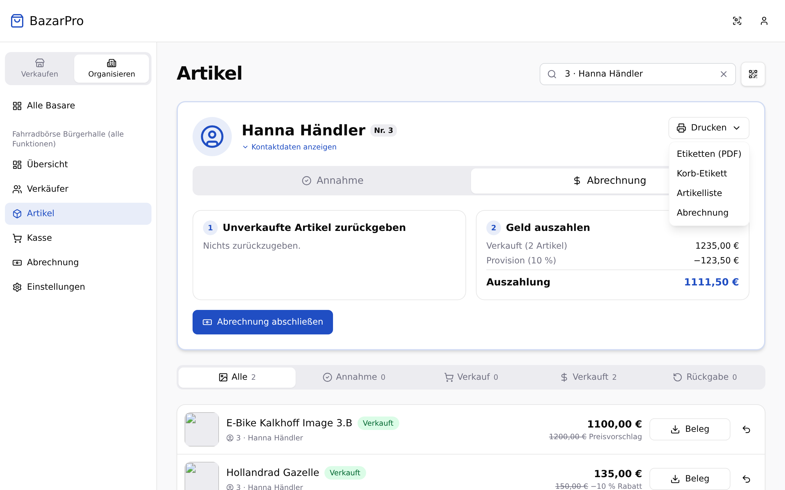

import { Aside, LinkCard, Steps } from '@astrojs/starlight/components';
import { Image } from 'astro:assets';
import abrechnungPdf from '../../../assets/ausdrucke/abrechnung.png';

Diese Seite zeigt, was du in BazarPro vor, während und nach dem Basar tust. Wie du den Basar planst und bewirbst, steht in den Ratgebern zur [Fahrradbörse](/ratgeber/fahrradboerse-organisieren/), zum [Kinderbasar](/ratgeber/kinderbasar-organisieren/) und zum [Skibasar](/ratgeber/skibasar-organisieren/).

## Die Übersicht deines Basars

Unter **Übersicht** zeigt **So läuft dein Basar** den Weg durch den Basar und hebt den fälligen Schritt hervor: Verkäufer anmelden lassen, Artikel annehmen, an der Kasse verkaufen und so weiter. Mit einem Klick kommst du zur passenden Seite.

Auf dem Handy liegt das Menü unten als Leiste. **Scannen** in der Mitte öffnet den Scanner, von dort kommst du direkt zu Etiketten und Ausweisen.

## Vorher: Verkäufer informieren und Helfer einteilen

### Verkäufer und Helfer einladen

Unter **Verkäufer** wählst du **Hinzufügen** und dann **Per E-Mail einladen**. Das ist Sache des Veranstalters, Helfer sehen den Punkt nicht.

<Steps>

1. **Adresse und Rolle angeben.** Trage die E-Mail-Adresse ein und wähle **Verkäufer** oder **Helfer**. Lade nur Personen ein, die damit rechnen.

   

2. **Einladung senden.** Die Person bekommt eine Mail mit einem Link und den Infos zu Datum und Ort des Basars.

3. **Annehmen lassen.** Mit einem kostenlosen Konto nimmt sie die Einladung an. Der Link gilt nur für das Konto mit der eingeladenen Adresse. Einen Zugangscode braucht sie nicht.

</Steps>

Offene Einladungen stehen auf derselben Seite, dort kannst du sie auch zurücknehmen. Pro Basar gehen höchstens **30 Einladungen in 24 Stunden** raus. Nach dem Ende des Basars lassen sich keine mehr verschicken.

### Nachrichten und Helfer

**Nachricht an Verkäufer.** Unter **Verkäufer** schreibst du mit **Nachricht an Verkäufer** allen deinen Verkäufern auf einmal, zum Beispiel „Abgabe erst ab 9 Uhr“. Du wählst, wer sie bekommt: alle, nur Verkäufer mit abgegebenen Artikeln oder nur die, die noch etwas abholen müssen. Die Nachricht geht per Mail raus und steht auf der Basar-Seite der Verkäufer.

- Bis zu **5 Nachrichten pro Basar und Tag**.
- **Wichtig** markierte Nachrichten erreichen auch Verkäufer, die Nachrichten vom Veranstalter abbestellt haben. Davon ist eine pro Tag möglich.

Die Mail am Vorabend und die Erinnerung zur Abholung verschickt BazarPro von selbst, siehe [Automatische Mails an Verkäufer](/veranstalter/basar-anlegen/#automatische-mails-an-verkäufer).

**Helfer.** Unter **Verkäufer** machst du Verkäufer mit **Als Helfer ernennen** zu Helfern, oder du suchst sie über **Hinzufügen** und **Helfer hinzufügen** nach Name, E-Mail oder Nummer. Helfer brauchen ein eigenes Konto. Sie können Ware annehmen, an der Kasse verkaufen, abrechnen sowie QR-Codes und Rechnungen drucken. Einstellungen ändern oder den Basar löschen können sie nicht.

## Annahme

Die Annahme läuft unter **Artikel** in deinem Basar.

<Steps>

1. **Etikett oder Ausweis scannen.** Mit **QR-Code scannen** scannst du das Etikett eines Artikels oder den **digitalen Ausweis** eines Verkäufers. Beim Ausweis siehst du alle angemeldeten Artikel dieses Verkäufers.

2. **Annehmen.** Einzelne Artikel nimmst du mit **Annehmen** an, alle Artikel eines Verkäufers auf einmal mit **Alle annehmen**. Dabei kannst du einen **Standort** zuordnen und eine **interne Notiz** hinterlegen, etwa „Schlüssel an Haken 12“. Die Notiz sehen nur du und deine Helfer.

3. **Fehlende Etiketten drucken.** Über **Etiketten (PDF)** druckst du die Etiketten eines Verkäufers direkt an der Annahme.

</Steps>

Ab der Annahme ist ein Artikel **Erhältlich** und für den Verkäufer gesperrt.

**Suchen nach Nummer:** Gib „17“, „Nr. 17“ oder „#17“ ins Suchfeld ein, dann siehst du genau die Artikel von Verkäufer 17.

**Spontane Verkäufer ohne Konto** legst du unter **Verkäufer** über **Hinzufügen** und **Verkäufer ohne Konto** an. Unter **Artikel** erfasst du ihre Artikel mit **Artikel erfassen**, mit **Speichern & nächster** auch viele hintereinander. Solange nichts verkauft ist, kannst du diese Artikel bearbeiten oder löschen.

## Kasse

Die **Kasse** öffnest du im Menü deines Basars. Sie ist für alle Artikel eines Käufers gedacht:

<Steps>

1. **Artikel scannen.** Mit der Handykamera (über **Kamera einschalten**), mit einem **Hand-Scanner** (er tippt den Code ins Feld) oder per Eingabe. Jeder Artikel landet im Warenkorb, auch wenn die Kamera ein Etikett mehrfach erkennt, nur einmal. Ein Signalton bestätigt jeden Scan.

2. **Preise prüfen.** Jede Zeile zeigt den aktuellen Preis mit Rabatt. Hat der Verkäufer einen Preisvorschlag angenommen oder einen Mindestpreis (VB) hinterlegt, wählst du den Preis aus.

3. **Kassieren und abschließen.** Bestätige den erhaltenen Betrag und klicke **Verkauf abschließen**. Gibt der Käufer seine E-Mail-Adresse an, bekommt er **einen** Beleg für den ganzen Einkauf. Jeder Verkäufer bekommt eine Mail für seine verkauften Artikel.

</Steps>

<Aside type="caution" title="Rot markierte Artikel">
  Ist ein Artikel schon verkauft (z. B. an einer anderen Kasse), nicht angenommen oder gehört er nicht zu deinem Basar, markiert die Kasse ihn rot. Entferne ihn aus dem Warenkorb, dann kannst du abschließen. Es wird immer alles oder nichts verkauft.
</Aside>

## Abrechnung und Rückgabe

Bei [Universal-Etiketten](/veranstalter/universal-etiketten/#ware-zurücksortieren) sortiert ihr die unverkaufte Ware vorher erst auf zehn Haufen und dann in die Körbe zurück. Die passenden **Sortierblätter** für die Körbe druckst du unter **Verkäufer**.

Nach dem Verkauf scannst du unter **Artikel** den **digitalen Ausweis** des Verkäufers. Unter **Abrechnung** siehst du:

- die verkauften Artikel, die **Provision** und die **Annahmegebühr**,
- die **Auszahlung**, oder – wenn die Annahmegebühr höher ist als der Erlös – den Betrag, den der Verkäufer zahlt (**Annahmegebühr kassieren**),
- die unverkauften Artikel, die zurückgehen.

Mit **Abrechnung abschließen** bestätigst du Auszahlung und Rückgabe. Danach sind Verkäufe und Rückgaben dieses Verkäufers gesperrt. Ist doch etwas falsch, nimmst du die Abrechnung mit **Abrechnung zurücknehmen** zurück – nimm dafür das ausgezahlte Geld wieder entgegen, damit die Kasse stimmt.

## Ausdrucke für einen Verkäufer

Vor allem Verkäufer ohne Konto sehen ihre Artikel und ihre Abrechnung nicht online. In den Details eines Verkäufers unter **Artikel** gibt es dafür zwei Ausdrucke als PDF:

- **Artikelliste drucken** – alle Artikel des Verkäufers mit Bezeichnung, Kategorie, Angaben wie Größe oder Rahmennummer, Preis und Status: verkauft mit dem erzielten Preis, nicht verkauft, nicht abgegeben oder zurückgegeben.
- **Abrechnung drucken** (im Tab **Abrechnung**) – Umsatz, Provision, Annahmegebühr und Auszahlung mit denselben Beträgen wie auf dem Bildschirm, darunter dieselbe Artikelliste. Der Ausdruck zeigt auch, ob schon abgerechnet ist.

<Image src={abrechnungPdf} alt="Ausdruck „Abrechnung“ mit Verkäufer, Umsatz, Provision, Auszahlung und der Artikelliste" />

## Abrechnung des Basars

Unter **Abrechnung** im Menü siehst du, wie viel Bargeld jetzt in der Kasse sein sollte, und wie es sich aufteilt: noch offene Auszahlungen, Provision und Annahmegebühren. Dazu, wie viele Verkäufer schon abgerechnet sind und wer noch eine Annahmegebühr zahlen muss.

## Nachweis der angebotenen Artikel

Unter **Abrechnung** lädst du mit **Nachweis als PDF** oder **Als Tabelle (CSV)** eine Liste aller angemeldeten Artikel herunter: Verkäufernummer, Name, Anschrift, Kontakt, Artikel mit Angaben wie der Rahmennummer, Preis und ob und wann er verkauft wurde. Hast du **Feste Daten für den Nachweis** eingeschaltet, stammen die Angaben vom Zeitpunkt der Anmeldung – spätere Änderungen am Profil ändern den Nachweis nicht.

<Aside type="caution">
  Die Datei enthält personenbezogene Daten. Gib sie nur weiter, wenn es nötig ist, zum Beispiel an die Polizei, und lösche sie, wenn du sie nicht mehr brauchst.
</Aside>

## Noch keinen Basar?

Annahme, Kasse und Abrechnung sind in BazarPro **kostenlos** – für Veranstalter, Verkäufer und Käufer.

<LinkCard
  title="Jetzt kostenlos Basar anlegen"
  description="Konto bei bazarpro.de erstellen und in zehn Minuten deinen Basar einrichten – ohne Provision für BazarPro, ohne Abo."
  href="https://bazarpro.de/register?role=organizer"
/>
