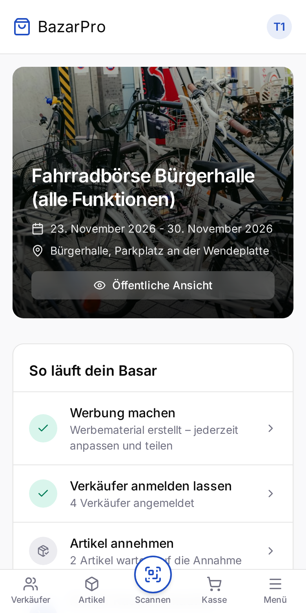
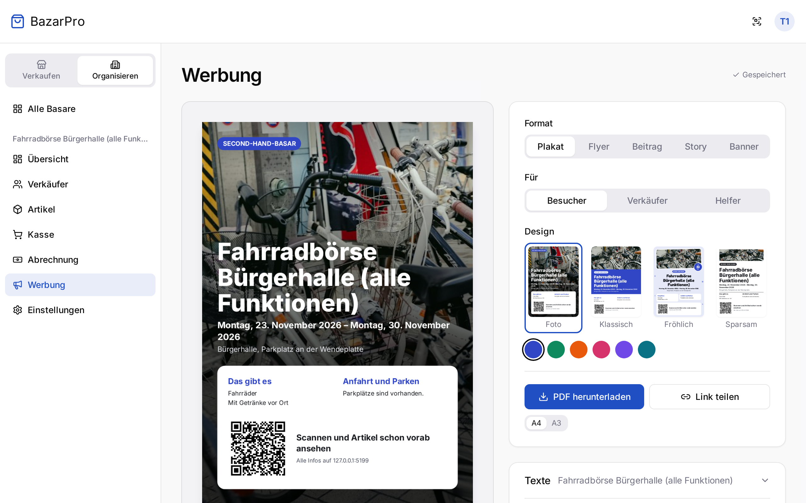
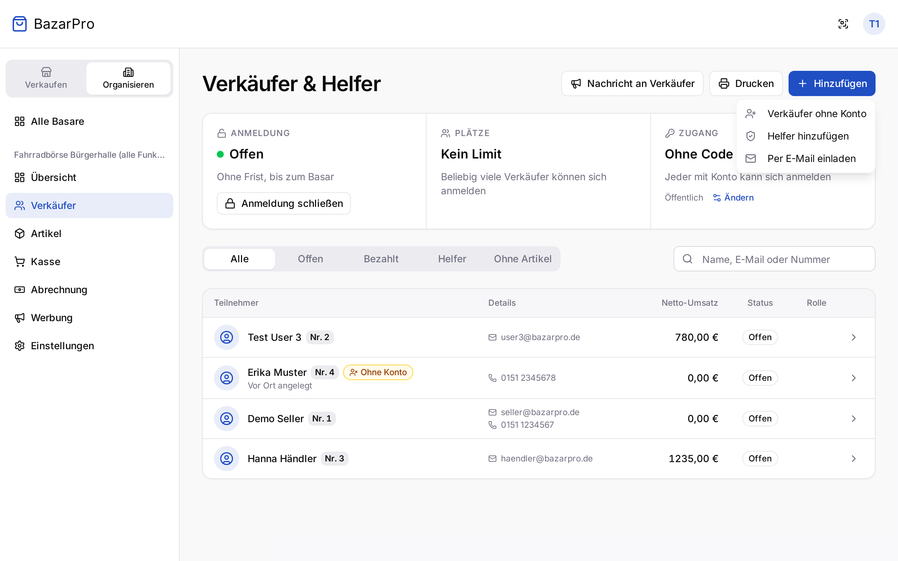
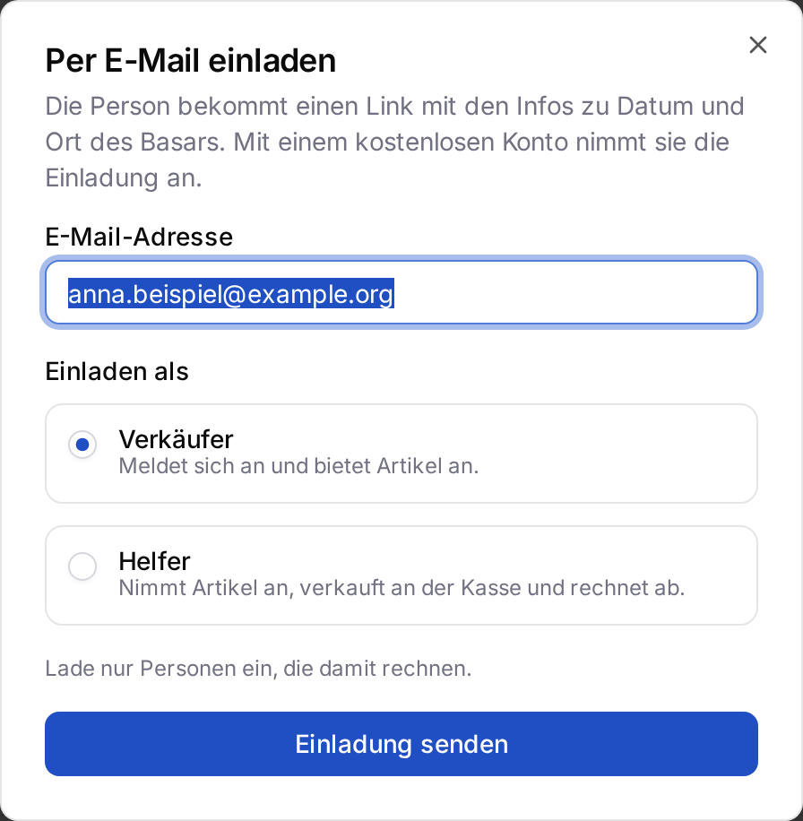
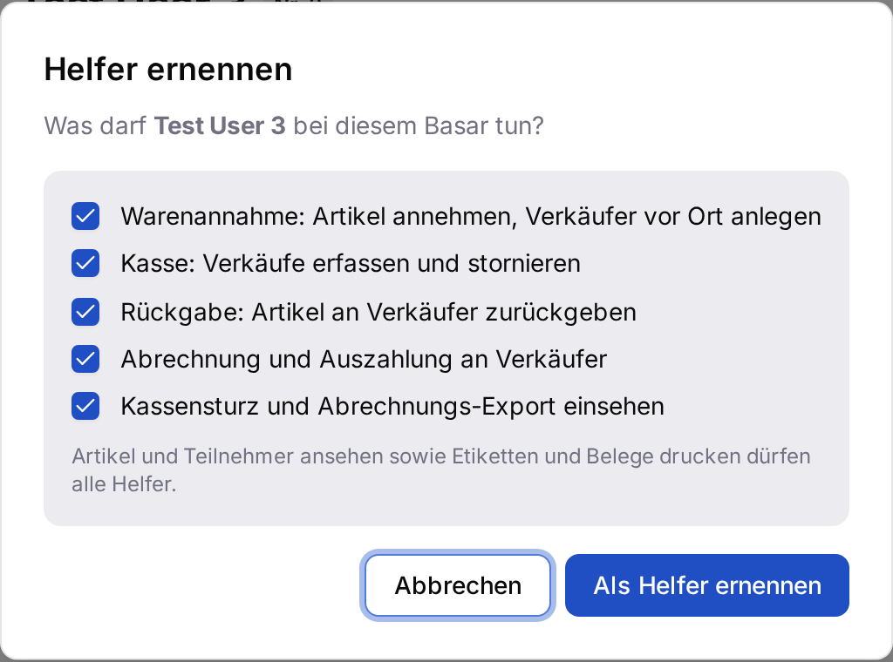
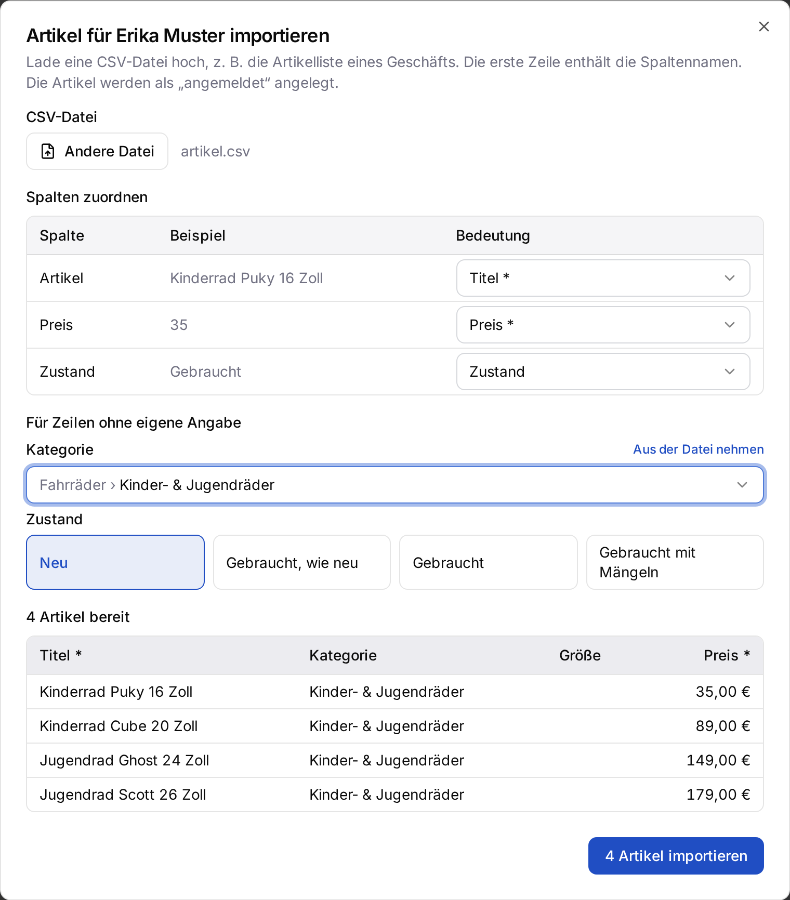
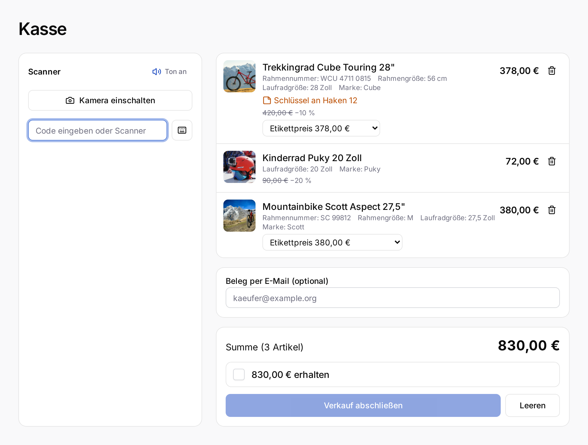
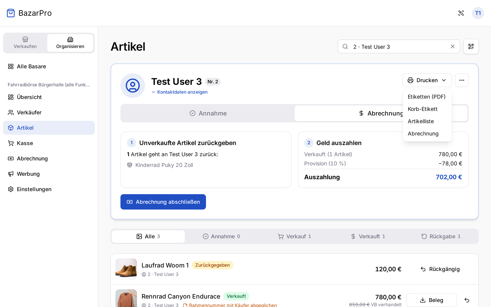

import { Aside, LinkCard, Steps } from '@astrojs/starlight/components';
import { Image } from 'astro:assets';
import abrechnungPdf from '../../../assets/ausdrucke/abrechnung.png';

Diese Seite zeigt, was du in BazarPro vor, während und nach dem Basar tust. Wie du den Basar planst und bewirbst, steht in den Ratgebern zur [Fahrradbörse](/ratgeber/fahrradboerse-organisieren/), zum [Kinderbasar](/ratgeber/kinderbasar-organisieren/) und zum [Skibasar](/ratgeber/skibasar-organisieren/).

## Die Übersicht deines Basars

Unter **Übersicht** zeigt **So läuft dein Basar** den Weg durch den Basar und hebt den fälligen Schritt hervor: Verkäufer anmelden lassen, Artikel annehmen, an der Kasse verkaufen und so weiter. Mit einem Klick kommst du zur passenden Seite.

Auf dem Handy liegt das Menü unten als Leiste. **Scannen** in der Mitte öffnet den Scanner, von dort kommst du direkt zu Etiketten und Ausweisen.

## Vorher: Verkäufer informieren und Helfer einteilen

### Werbung

Unter **Werbung** erstellt BazarPro aus den Angaben deines Basars Plakate, Flyer und Bilder für Social Media. Du findest die Seite auch in der Übersicht unter **Werbung machen**.

- **Format** – **Plakat** (A4 oder A3), **Flyer** (zwei pro A4-Blatt, auf Wunsch mit Rückseite), **Beitrag** und **Story** für Social Media oder ein **Banner**.
- **Für** – **Besucher**, **Verkäufer** oder **Helfer**. Je nach Zielgruppe ändern sich Überschrift, Inhalte und der Text am QR-Code, der zu deinem Basar führt.
- **Design und Farbe** – vier Designs, darunter **Sparsam** mit wenig Farbe für den eigenen Drucker.
- **Texte, Inhalte und Bild** – passe Überschrift und Texte an und wähle, welche Blöcke erscheinen, etwa „Das gibt es“, „So verkaufst du“ oder „Anfahrt und Parken“. Statt des Basarbilds kannst du ein eigenes Bild nehmen, es bleibt auf deinem Gerät.

Deine Texte speichert BazarPro beim Basar. Mit **PDF herunterladen** oder **Bild herunterladen** bekommst du die Datei, mit **Link teilen** schickst du den Link zum Basar weiter.

### Verkäufer und Helfer einladen

Unter **Verkäufer** wählst du **Hinzufügen** und dann **Per E-Mail einladen**. Das ist Sache des Veranstalters, Helfer sehen den Punkt nicht.

<Steps>

1. **Adresse und Rolle angeben.** Trage die E-Mail-Adresse ein und wähle **Verkäufer** oder **Helfer**. Lade nur Personen ein, die damit rechnen.

   

2. **Einladung senden.** Die Person bekommt eine Mail mit einem Link und den Infos zu Datum und Ort des Basars.

3. **Annehmen lassen.** Mit einem kostenlosen Konto nimmt sie die Einladung an. Der Link gilt nur für das Konto mit der eingeladenen Adresse. Einen Zugangscode braucht sie nicht.

</Steps>

Offene Einladungen stehen auf derselben Seite, dort kannst du sie auch zurücknehmen. Pro Basar gehen höchstens **30 Einladungen in 24 Stunden** raus. Nach dem Ende des Basars lassen sich keine mehr verschicken.

### Anmeldung und Teilnahme steuern

Oben unter **Verkäufer** zeigt der Kasten **Anmeldung**, ob sich Verkäufer gerade selbst anmelden können, bis wann, wie viele Plätze für Verkäufer und für Artikel noch frei sind und welchen Zugangscode Verkäufer brauchen. Mit **Anmeldung schließen** kommen neue Verkäufer nur noch per Einladung dazu, mit **Anmeldung öffnen** geht es wieder. Das Zeitfenster und die Grenzen legst du in den [Einstellungen](/veranstalter/basar-anlegen/) fest.

**Verkäufer ohne Artikel.** Der Reiter **Ohne Artikel** listet alle, die sich angemeldet, aber noch keinen Artikel angemeldet haben. Mit **Erinnern** schreibst du ihnen eine Nachricht. Mit **Alle abmelden** meldest du sie ab, wenn die Plätze knapp sind: Sie bekommen eine Mail, auf Wunsch mit deiner Nachricht, und ihre Plätze werden frei. Wer möchte, kann sich danach wieder anmelden, solange Plätze frei sind. Helfer und Verkäufer ohne Konto sind nicht dabei.

**Verkäufer ausschließen.** Wählst du unter **Artikel** einen Verkäufer, findest du im Menü **…** den Punkt **Vom Basar ausschließen**, zum Beispiel wenn jemand beim letzten Basar seine Artikel nicht abgeholt hat. Das geht nur, solange er keine angemeldeten Artikel hat, und nur vor dem Ende des Basars. Die Person bekommt eine Mail und kann sich nicht wieder anmelden, auch nicht mit Zugangscode oder Einladung. Bereits abgegebene Artikel gehen in die normale Rückgabe, Verkäufe und Abrechnung bleiben. Mit **Ausschluss zurücknehmen** machst du es rückgängig.

**Nicht abgegebene Artikel ablehnen.** Ist die Abgabezeit vorbei, zeigt **Artikel** oben einen Kasten mit der Zahl der angemeldeten, aber nicht abgegebenen Artikel. Mit **Nicht abgegebene ablehnen** erscheinen sie nicht mehr online und können an der Kasse nicht verkauft werden. Jeder Verkäufer bekommt eine Mail mit seinen Artikeln. Vor dem Ende der Abgabe findest du dieselbe Aktion im Menü **…** neben der Suche. Einzelne Ablehnungen nimmst du im Reiter **Abgelehnt** zurück.

### Nachrichten und Helfer

**Nachricht an Verkäufer.** Unter **Verkäufer** schreibst du mit **Nachricht an Verkäufer** allen deinen Verkäufern auf einmal, zum Beispiel „Abgabe erst ab 9 Uhr“. Du wählst, wer sie bekommt: alle, nur Verkäufer ohne angemeldete Artikel, nur Verkäufer mit abgegebenen Artikeln oder nur die, die noch etwas abholen müssen. Die Nachricht geht per Mail raus und steht auf der Basar-Seite der Verkäufer.

- Bis zu **5 Nachrichten pro Basar und Tag**.
- **Wichtig** markierte Nachrichten erreichen auch Verkäufer, die Nachrichten vom Veranstalter abbestellt haben. Davon ist eine pro Tag möglich.

Die Mail am Vorabend und die Erinnerung zur Abholung verschickt BazarPro von selbst, siehe [Automatische Mails an Verkäufer](/veranstalter/basar-anlegen/#automatische-mails-an-verkäufer).

**Helfer.** Unter **Verkäufer** machst du Verkäufer mit **Als Helfer ernennen** zu Helfern, oder du suchst sie über **Hinzufügen** und **Helfer hinzufügen** nach Name, E-Mail oder Nummer. Helfer brauchen ein eigenes Konto. Beim Ernennen wählst du, was die Person bei deinem Basar tun darf:

- **Warenannahme** – Artikel annehmen und Verkäufer vor Ort anlegen
- **Kasse** – Verkäufe erfassen und stornieren
- **Rückgabe** – Artikel an Verkäufer zurückgeben
- **Abrechnung und Auszahlung** an Verkäufer
- **Kassensturz und Abrechnungs-Export** einsehen

Artikel und Teilnehmer ansehen sowie Etiketten und Belege drucken dürfen alle Helfer. So kann zum Beispiel jemand nur an der Kasse stehen, ohne Geld auszuzahlen. Die Rechte änderst du später unter **Artikel** im Menü **…** des Helfers mit **Helfer-Rechte ändern**. Einstellungen ändern, Verkäufer einladen oder den Basar löschen können Helfer nicht.

## Annahme

Die Annahme läuft unter **Artikel** in deinem Basar.

<Steps>

1. **Etikett oder Ausweis scannen.** Mit **QR-Code scannen** scannst du das Etikett eines Artikels oder den **digitalen Ausweis** eines Verkäufers. Beim Ausweis siehst du alle angemeldeten Artikel dieses Verkäufers.

2. **Annehmen.** Einzelne Artikel nimmst du mit **Annehmen** an, alle Artikel eines Verkäufers auf einmal mit **Alle annehmen**. Dabei kannst du einen **Standort** zuordnen und eine **interne Notiz** hinterlegen, etwa „Schlüssel an Haken 12“. Die Notiz sehen nur du und deine Helfer.

3. **Fehlende Etiketten drucken.** Über **Drucken** und **Etiketten (PDF)** druckst du die Etiketten eines Verkäufers direkt an der Annahme.

</Steps>

Ab der Annahme ist ein Artikel **Erhältlich** und für den Verkäufer gesperrt.

**Gebührengruppe prüfen:** Hat ein Verkäufer bei der Anmeldung eine [Gebührengruppe](/veranstalter/basar-anlegen/) angegeben, etwa „Vereinsmitglieder“, zeigt die Annahme den Kasten **Ermäßigt: … – Nachweis prüfen**. Stimmt der Nachweis, tippst du auf **Bestätigen**, sonst auf **Entfernen**, dann gelten die normalen Gebühren. Vorher lässt sich kein Artikel dieses Verkäufers annehmen. Unter **Verkäufer** zeigt der Tab **Gruppen**, wie viele Angaben noch offen sind.

**Suchen nach Nummer:** Gib „17“, „Nr. 17“ oder „#17“ ins Suchfeld ein, dann siehst du genau die Artikel von Verkäufer 17.

### Verkäufer ohne Konto

Spontane Verkäufer ohne Konto, etwa ein Fahrradladen oder jemand, der ohne Anmeldung vorbeikommt, legst du unter **Verkäufer** über **Hinzufügen** und **Verkäufer ohne Konto** an. Eine E-Mail-Adresse ist freiwillig, dorthin geht dann die Nachricht über Verkäufe.

Ihre Artikel erfasst du in den Details des Verkäufers unter **Artikel** mit **Artikel hinzufügen**:

- **Einzeln erfassen** – ein Artikel nach dem anderen, mit **Speichern & nächster** auch viele hintereinander.
- **Aus CSV-Datei importieren** – die ganze Liste auf einmal, zum Beispiel die Artikelliste eines Geschäfts aus einer Tabellenkalkulation.

<Steps>

1. **Datei wählen.** Die erste Zeile der CSV-Datei enthält die Spaltennamen, jede weitere Zeile ist ein Artikel.

2. **Spalten zuordnen.** BazarPro erkennt die meisten Spalten selbst. Prüfe für jede Spalte, ob sie **Titel**, **Preis**, **Kategorie**, **Zustand**, **Größe** oder **Beschreibung** ist, oder wähle **Nicht übernehmen**. Titel und Preis sind Pflicht.

3. **Fehlendes ergänzen.** Unter **Für Zeilen ohne eigene Angabe** wählst du eine Kategorie und einen Zustand für alle Zeilen, in denen die Datei keine hat.

4. **Importieren.** Die Vorschau zeigt alle Artikel, die übernommen werden. Zeilen mit Fehlern, etwa ohne Titel oder mit einem Preis, der keine Zahl ist, listet BazarPro mit Zeilennummer auf und überspringt sie. Klappt etwas nicht, wird gar nichts angelegt.

</Steps>

Die Artikel stehen danach als **Angemeldet** beim Verkäufer. Nimm sie wie gewohnt an und drucke die Etiketten. Solange nichts verkauft ist, kannst du sie bearbeiten oder löschen.

## Kasse

Die **Kasse** öffnest du im Menü deines Basars. Sie ist für alle Artikel eines Käufers gedacht:

<Steps>

1. **Artikel scannen.** Mit der Handykamera (über **Kamera einschalten**), mit einem **Hand-Scanner** (er tippt den Code ins Feld) oder per Eingabe. Jeder Artikel landet im Warenkorb, auch wenn die Kamera ein Etikett mehrfach erkennt, nur einmal. Ein Signalton bestätigt jeden Scan.

2. **Preise prüfen.** Jede Zeile zeigt den aktuellen Preis mit Rabatt. Hat der Verkäufer einen Preisvorschlag angenommen oder einen Mindestpreis (VB) hinterlegt, wählst du den Preis aus.

3. **Kassieren und abschließen.** Bestätige den erhaltenen Betrag und klicke **Verkauf abschließen**. Gibt der Käufer seine E-Mail-Adresse an, bekommt er **einen** Beleg für den ganzen Einkauf. Jeder Verkäufer bekommt eine Mail für seine verkauften Artikel.

</Steps>

<Aside type="caution" title="Rot markierte Artikel">
  Ist ein Artikel schon verkauft (z. B. an einer anderen Kasse), nicht angenommen oder gehört er nicht zu deinem Basar, markiert die Kasse ihn rot. Entferne ihn aus dem Warenkorb, dann kannst du abschließen. Es wird immer alles oder nichts verkauft.
</Aside>

### Ohne Internet

Fällt in der Halle das Netz aus, arbeiten Kasse und Warenannahme in der **BazarPro-App** für iOS und Android weiter. Die App lädt den Basar vorher auf das Gerät, die Übersicht zeigt dann **Offline bereit** mit der Zahl der Artikel und dem Stand. Mit **Jetzt laden** holst du den neuesten Stand, zum Beispiel morgens vor der Öffnung. Im Browser geht das nicht, weil er die Seite ohne Internet gar nicht erst lädt.

- Ohne Verbindung zeigt die App **Offline – zuletzt geladener Stand**. Verkäufe und Annahmen speichert sie auf dem Gerät und bucht sie nach, sobald wieder Internet da ist. Alles andere, etwa die Abrechnung, geht erst wieder mit Internet.
- Der **digitale Ausweis** der Verkäufer funktioniert auch offline, wenn sie ihn einmal mit Internet geöffnet haben.
- Geht ein Gerät des Teams verloren, machst du mit **Ausweis-Codes erneuern** die alten Codes der Ausweise ungültig.

## Abrechnung und Rückgabe

Bei [Universal-Etiketten](/veranstalter/universal-etiketten/#ware-zurücksortieren) sortiert ihr die unverkaufte Ware vorher erst auf zehn Haufen und dann in die Körbe zurück. Die passenden **Sortierblätter** für die Körbe druckst du unter **Verkäufer**.

Nach dem Verkauf scannst du unter **Artikel** den **digitalen Ausweis** des Verkäufers. Unter **Abrechnung** siehst du:

- die verkauften Artikel, die **Provision** und die **Annahmegebühr**,
- die **Auszahlung**, oder – wenn die Annahmegebühr höher ist als der Erlös – den Betrag, den der Verkäufer zahlt (**Annahmegebühr kassieren**),
- die unverkauften Artikel, die zurückgehen.

Mit **Abrechnung abschließen** bestätigst du Auszahlung und Rückgabe. Danach sind Verkäufe und Rückgaben dieses Verkäufers gesperrt. Ist doch etwas falsch, nimmst du die Abrechnung mit **Abrechnung zurücknehmen** zurück – nimm dafür das ausgezahlte Geld wieder entgegen, damit die Kasse stimmt.

## Nach dem Basar: übrige Artikel

Artikel, die nach dem Basar noch **Erhältlich** sind, also weder verkauft noch abgeholt, setzt BazarPro in der Nacht nach dem Basar (und nach dem Ende der Abholung) von selbst auf **Zurückgegeben**. Verkäufer, bei denen nichts verkauft wurde und keine Annahmegebühr offen ist, werden dabei mit 0 € abgerechnet. Alle anderen rechnest du wie gewohnt ab; bis dahin stehen sie im Kassensturz als ausstehend.

- **Welche Artikel?** Im Reiter **Rückgabe** sind sie mit **automatisch** gekennzeichnet; **Nur diese anzeigen** listet genau sie, damit du sie mit den Verkäufern klären kannst.
- **Sofort statt nachts:** Im Menü **…** neben der Suche gibst du mit **Alle übrigen zurückgeben** nach einer Rückfrage alle übrigen Artikel auf einmal zurück. Verkaufte und nie abgegebene Artikel bleiben, wie sie sind; abgerechnet wird dabei niemand.

## Ausdrucke für einen Verkäufer

Vor allem Verkäufer ohne Konto sehen ihre Artikel und ihre Abrechnung nicht online. In den Details eines Verkäufers unter **Artikel** gibt es dafür zwei Ausdrucke als PDF, beide im Menü **Drucken**:

- **Artikelliste** – alle Artikel des Verkäufers mit Bezeichnung, Kategorie, Angaben wie Größe oder Rahmennummer, Preis und Status: verkauft mit dem erzielten Preis, nicht verkauft, nicht abgegeben oder zurückgegeben.
- **Abrechnung** – Umsatz, Provision, Annahmegebühr und Auszahlung mit denselben Beträgen wie auf dem Bildschirm, darunter dieselbe Artikelliste. Der Ausdruck zeigt auch, ob schon abgerechnet ist.

<Image src={abrechnungPdf} alt="Ausdruck „Abrechnung“ mit Verkäufer, Umsatz, Provision, Auszahlung und der Artikelliste" />

## Abrechnung des Basars

Unter **Abrechnung** im Menü siehst du, wie viel Bargeld jetzt in der Kasse sein sollte, und wie es sich aufteilt: noch offene Auszahlungen, Provision und Annahmegebühren. Dazu, wie viele Verkäufer schon abgerechnet sind und wer noch eine Annahmegebühr zahlen muss. Direktverkäufe, Rabatte und was der Gebühren-Deckel zurückgibt, stehen getrennt.

**Abrechnung exportieren.** Als Veranstalter musst du die Abrechnung aufbewahren (§ 147 AO). Unter **Abrechnung exportieren** lädst du sie als **PDF** herunter, oder als Tabelle (CSV) getrennt nach **Verkäufern** und **Verkäufen**. BazarPro löscht die Abrechnung 8 Jahre nach Ende des Jahres, in dem der Basar war. Lege die Dateien zu deinen Unterlagen und bewahre sie sicher auf, sie enthalten Namen und Anschriften der Verkäufer.

## Nachweis der angebotenen Artikel

Unter **Abrechnung** lädst du mit **Nachweis als PDF** oder **Als Tabelle (CSV)** eine Liste aller angemeldeten Artikel herunter: Verkäufernummer, Name, Anschrift, Kontakt, Artikel mit Angaben wie der Rahmennummer, Preis und ob und wann er verkauft wurde. Hast du **Feste Daten für den Nachweis** eingeschaltet, stammen die Angaben vom Zeitpunkt der Anmeldung – spätere Änderungen am Profil ändern den Nachweis nicht.

<Aside type="caution">
  Die Datei enthält personenbezogene Daten. Gib sie nur weiter, wenn es nötig ist, zum Beispiel an die Polizei, und lösche sie, wenn du sie nicht mehr brauchst.
</Aside>

## Noch keinen Basar?

Annahme, Kasse und Abrechnung sind in BazarPro **kostenlos** – für Veranstalter, Verkäufer und Käufer.

<LinkCard
  title="Jetzt kostenlos Basar anlegen"
  description="Konto bei bazarpro.de erstellen und in zehn Minuten deinen Basar einrichten – ohne Provision für BazarPro, ohne Abo."
  href="https://bazarpro.de/register?role=organizer"
/>
