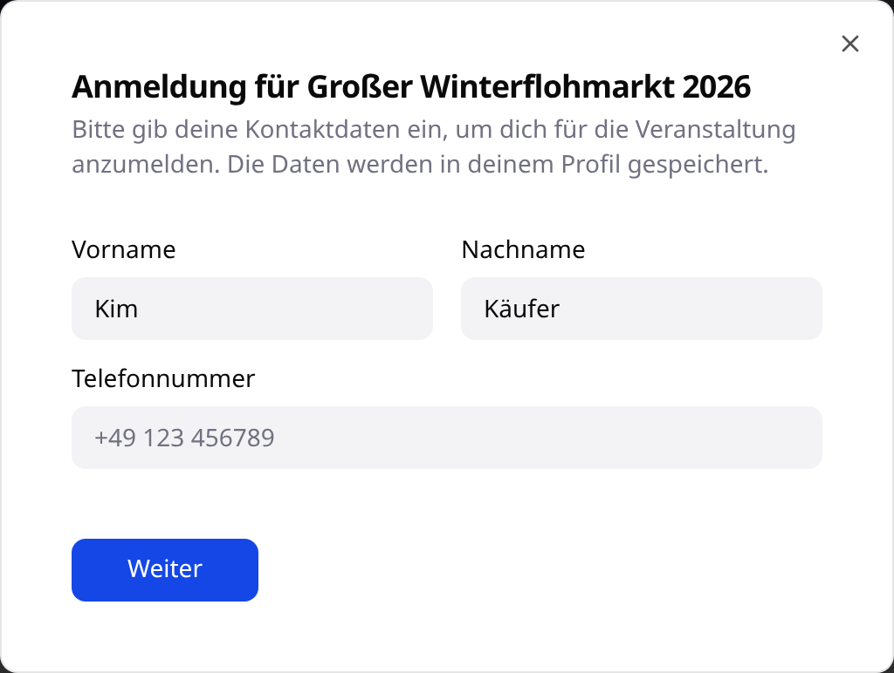
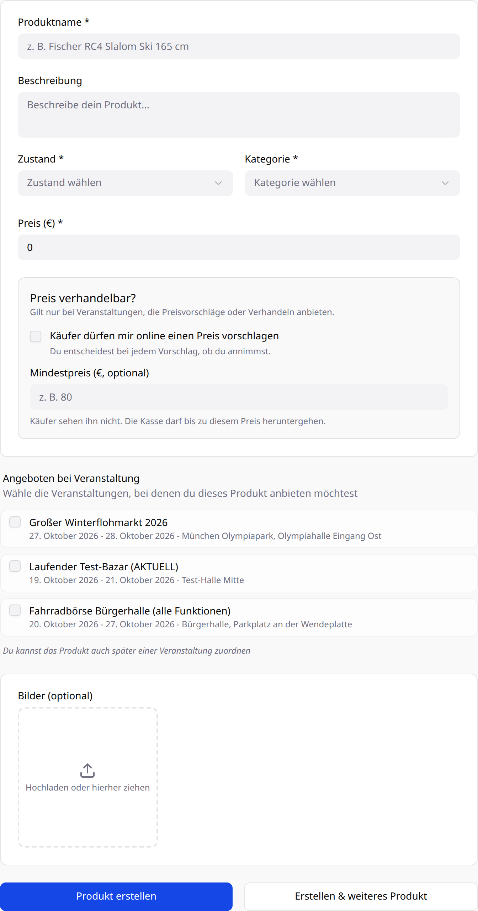
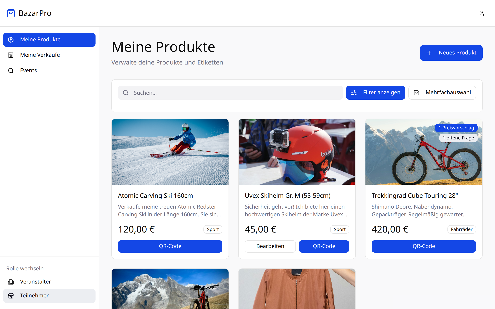

import { Aside, Steps } from '@astrojs/starlight/components';

In dieser Anleitung meldest du dich bei einem Basar als Verkäufer an, legst einen Artikel an und druckst sein QR-Etikett. Wenn du mehrere Artikel verkaufen möchtest, wiederholst du nur den zweiten Teil.

**Du brauchst:** ein BazarPro-Konto, Fotos deiner Artikel (falls der Basar welche verlangt) und – falls der Veranstalter einen vergibt – den Zugangscode.

## Teil 1: Beim Basar anmelden

<Steps>

1. **Zur Rolle „Teilnehmer“ wechseln.** Unten in der Seitenleiste unter **Rolle wechseln** auf **Teilnehmer** klicken.

2. **Den Basar öffnen.** Über **Events** in der Seitenleiste findest du alle Basare, an denen du teilnehmen kannst. Hat dir der Veranstalter einen Link geschickt, öffne einfach diesen.

3. **Bedingungen lesen.** In der Seitenleiste der Basar-Seite stehen unter **Gebühren & Bedingungen** Provision, Annahmegebühr, Artikel-Limit, Abgabe- und Abholzeiten und was beim Verkauf erlaubt ist – mit einem Rechenbeispiel, wie viel du bekommst.

4. **„Als Verkäufer beitreten“ klicken.**

   

5. **Kontaktdaten prüfen.** Beim ersten Mal fragt BazarPro nach Name, Anschrift und Telefonnummer, damit dich der Veranstalter erreichen kann. Die Angaben werden in deinem Profil gespeichert.

   

6. **Zugangscode eingeben (falls nötig)** und mit **Anmelden bestätigen** abschließen. Verlangt der Basar Privatverkäufer, bestätigst du vorher: „Ich verkaufe als Privatperson und nicht gewerblich.“

</Steps>

Nach der Anmeldung hast du bei diesem Basar eine **Verkäufernummer**, zum Beispiel „Nr. 17“. Sie steht auf deinen Etiketten, auf der Basar-Seite und in den Mails.

<Aside type="caution" title="Anmeldung klappt nicht?">
  - **„Eingegebener Code ist falsch!“** – prüfe den Code beim Veranstalter, Groß- und Kleinschreibung zählt.
  - **Teilnehmerlimit erreicht** – der Basar hat bereits so viele Verkäufer, wie der Veranstalter zulässt.
  - **Veranstaltung liegt in der Vergangenheit** – bei beendeten Basaren ist keine Anmeldung mehr möglich.
</Aside>

## Teil 2: Artikel anlegen

<Steps>

1. **„Neues Produkt“ öffnen.** Unter **Meine Produkte** oben rechts auf **Neues Produkt** klicken.

2. **Angaben ausfüllen.**

   

   - **Produktname** – mindestens 3 Zeichen, z. B. „Hollandrad 28 Zoll“.
   - **Beschreibung** – optional, aber hilfreich: Alter, Gebrauchsspuren, Zubehör.
   - **Zustand** – Neu, Gebraucht wie neu, Gebraucht oder Gebraucht mit Mängeln.
   - **Kategorie** – der Basar akzeptiert nur die Kategorien, die der Veranstalter freigegeben hat. Je nach Kategorie fragt BazarPro nach weiteren Angaben, etwa **Größe** und **Marke** bei Kleidung oder **Rahmennummer** bei Fahrrädern. Felder mit `*` verlangt der Basar.
   - **Preis (€)** – dein Verkaufspreis. Die Provision des Veranstalters wird davon abgezogen.
   - **Mindestpreis** (optional) – nur bei Basaren mit Verhandeln vor Ort. Käufer sehen „VB“, aber nicht den Mindestpreis.
   - **Bilder** – bei den meisten Basaren mindestens ein Foto, bei manchen freiwillig.
   - **Angeboten bei Veranstaltung** – wähle den Basar aus. Du kannst einen Artikel auch mehreren Basaren zuordnen oder das später nachholen.

3. **Speichern.** Mit **Produkt erstellen** bist du fertig. Mit **Erstellen & weiteres Produkt** legst du direkt das nächste Teil an – Basar, Kategorie und Zustand bleiben stehen. Der Artikel steht jetzt im Basar mit dem Status **Angemeldet**.

</Steps>

Begrenzt der Veranstalter die **Artikel pro Verkäufer**, sagt dir BazarPro beim Anmelden, wie viele noch gehen.

**Bestehende Artikel zu einem Basar hinzufügen:** Unter **Meine Produkte** mit **Mehrfachauswahl** Artikel markieren und **Zu Event hinzufügen** wählen. Fehlt einem Artikel etwas, das der Basar verlangt – ein Foto oder eine Pflichtangabe –, führt dich **Artikel ergänzen** durch diese Artikel, einen nach dem anderen.

<Aside type="tip" title="Gute Fotos verkaufen besser">
  Fotografiere bei Tageslicht vor einem ruhigen Hintergrund und zeige den ganzen Artikel. Ein zweites Foto von Mängeln oder Details schafft Vertrauen – und erspart Rückfragen beim Basar.
</Aside>

## Teil 3: Etiketten drucken und anbringen

- **Einzelnes Etikett:** auf der Artikelkarte auf **QR-Code** klicken.
- **Alle Etiketten auf einmal:** mit **Mehrfachauswahl** Artikel markieren und **Etiketten als PDF** herunterladen.

Auf dem Etikett stehen QR-Code, Titel, deine Verkäufernummer und die Größe. Das Format legt der Veranstalter fest: große Etiketten (12 pro Seite) oder kleine (40 pro Seite) zum Ausschneiden. Den Preis druckt BazarPro nur, wenn der Basar das so eingestellt hat.

Drucke die Etiketten aus und befestige sie gut sichtbar am Artikel – an Kleidung zum Beispiel mit einer Sicherheitsnadel, an einem Fahrrad am Lenker. Bring die Artikel dann zur Warenannahme des Basars.

## Was passiert danach?

- **Am Vorabend um 18 Uhr** bekommst du eine Mail mit Abgabezeit, Ort, deiner Verkäufernummer und der Anzahl deiner Artikel.
- **Bis zur Warenannahme** kannst du den Artikel bearbeiten oder löschen. Führt der Basar einen Nachweis, sind Titel, Kategorie, Preis und Pflichtangaben ab der Anmeldung fest, und abmelden kannst du nur bis Basarbeginn.
- **Ab der Warenannahme** ist der Artikel **Erhältlich** und für Änderungen gesperrt.
- **Während des Basars** kannst du einem erhältlichen Artikel einen **Rabatt** geben, wenn der Basar das erlaubt – höchstens bis zum Höchstrabatt des Veranstalters. Den Rabatt kannst du für die Dauer des Basars nicht wieder zurücknehmen.
- **Nach dem Verkauf** siehst du den Status **Verkauft** sofort in BazarPro und bekommst eine Mail. Nach dem Basar erinnert dich BazarPro an die Abholung von Geld und unverkauften Artikeln.

**Nachrichten vom Veranstalter** findest du auf der Basar-Seite. Neue Nachrichten markiert BazarPro im Menü bei **Events**.

## Welche Mails bekomme ich?

Unter **Konto → Benachrichtigungen** schaltest du einzelne Arten von Mails ab: Verkäufe, Preisvorschläge, Fragen, deine eigenen Vorschläge und Fragen als Käufer, Erinnerungen zum Basar und Nachrichten vom Veranstalter. Jede dieser Mails hat außerdem einen Abmeldelink. Kaufbelege und Hinweise zu deinem Konto kommen immer, ebenso Nachrichten, die der Veranstalter als **wichtig** markiert.

Mails bekommst du in der Sprache, die du in BazarPro eingestellt hast – Deutsch oder Englisch.
